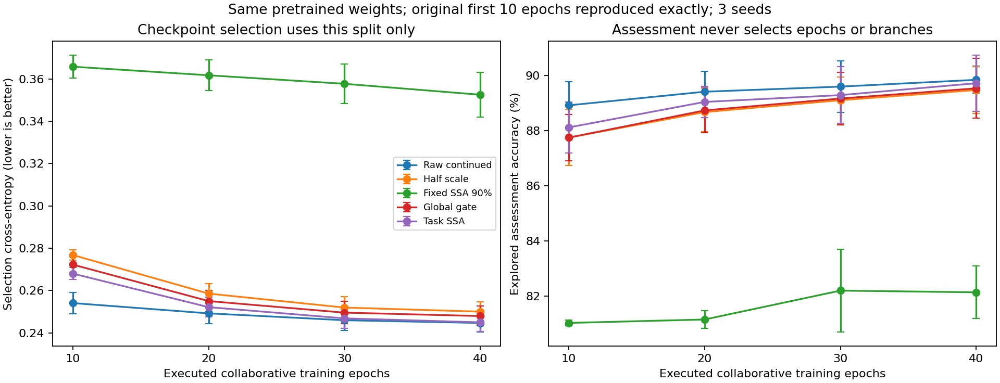

# 第十一轮：协同训练从10轮延长到40轮

用户要求把协同训练延长至40轮。本轮任务SSA的内部评价准确率从88.11%提高到89.71%，同预算原始输入从88.91%提高到89.83%。差距从−0.80缩小至−0.12个百分点，仍未显示稳定超过原始输入的收益。不能沿用“任务三个种子全输”的旧结论，也不能把接近原始输入写成已证明有效去噪。

## 本轮只改变什么

预先提交的协议和执行版本为 `f4fb9a8`，协议见 `configs/classification_40_protocol.json`。复用第十轮三个预训练检查点，数据、划分、标准化、CNN、SSA嵌入32及全部成分、损失和初始化不变。不加人工污染、不接SRD、不开官方TEST。

每个种子下五个分支均完整执行40轮：每轮40批，每批最多64条，共1600次分类器更新；任务SSA及全局尺度分支另有1600次选择头更新。原始、半缩放、固定SSA也获得同等分类器更新预算。共15次分支训练，18个最终保存模型（含三个复用预训练模型）。

旧实验未保存完整优化器状态，不能从旧最佳权重直接假装无缝续训。本轮从共同预训练模型重跑，保留原10轮学习率轨迹，之后维持其下限0.0009；不将余弦周期同时改成40轮。第10轮的最佳分类器权重、选择头权重及批次顺序与旧运行逐组核对，15组均完全复现。这个结论只针对已锁定调度的预算延长，不代表所有40轮学习率方案。

在10/20/30/40轮各保存此前selection交叉熵最小的成对模型，同时另存真实第40轮终态。先完成所有训练，再统一计算评价准确率；不按评价成绩挑轮数。selection最小损失随候选轮数增加不可能变差，不能据此单独宣称模型有效。

## 最佳检查点的内部评价

以下均由selection CE选检查点，准确率为三个训练种子的均值；每个种子评价相同541条样本。内部评价此前已被探索，不是新的独立测试。

| 方法 | 10轮预算准确率% | 40轮预算准确率% |
|---|---:|---:|
| 原始输入继续训练 | 88.91 | 89.83 |
| 固定0.5缩放 | 87.74 | 89.46 |
| 固定SSA：90%轨迹能量 | 81.02 | 82.13 |
| 学习全局缩放 | 87.74 | 89.53 |
| 任务加权SSA | 88.11 | 89.71 |

共同预训练模型仍为88.42%，本轮未重训。任务SSA相对自身10轮结果提高1.60个百分点；原始继续训练也提高0.92个百分点。任务自身的进步与超过原始输入，是两个不同判断。

40轮预算下，原始为89.83%±0.49%、任务SSA为89.71%±1.02%（样本标准差，三个训练种子）。配对差异如下：

| 种子 | 原始准确率% | 任务SSA准确率% | 任务−原始，百分点 |
|---|---:|---:|---:|
| 42 | 89.65 | 89.65 | 0.00 |
| 43 | 89.46 | 88.72 | −0.74 |
| 44 | 90.39 | 90.76 | +0.37 |

一平、一负、一正，净差分别为0/−4/+2个样本；平均差−0.12个百分点。三个训练种子不是三套独立数据，不能据如此小的差值判断统计显著。原始/任务的拟合准确率为90.85%/90.81%，selection准确率90.99%/90.56%；差异也并非只在评价段出现。

| 已执行预算 | 原始准确率% | 任务SSA准确率% | 任务−原始，百分点 |
|---|---:|---:|---:|
| 10轮 | 88.91 | 88.11 | −0.80 |
| 20轮 | 89.40 | 89.03 | −0.37 |
| 30轮 | 89.59 | 89.28 | −0.31 |
| 40轮 | 89.83 | 89.71 | −0.12 |



图中误差线是三个种子的样本标准差，准确率轴局部放大以便观察变化，不代表大幅绝对收益。右图评价分数只用于报告，不用于选检查点。

## 实际第40轮终态单独报告

原始与任务的selection最佳轮次均为35/38/39，不能把上述89.83%/89.71%标为“实际第40轮的分数”。所有分支仍执行到了第40轮，分类器更新数均为1600。

| 方法 | 40轮内selection最佳模型准确率% | 真实第40轮终态准确率% |
|---|---:|---:|
| 原始输入继续训练 | 89.83 | 88.48 |
| 固定0.5缩放 | 89.46 | 88.23 |
| 固定SSA | 82.13 | 81.89 |
| 学习全局缩放 | 89.53 | 88.29 |
| 任务加权SSA | 89.71 | 88.60 |

终态的任务−原始为+0.12个百分点，三个种子分别+0.18/+0.37/−0.18；同样没有稳定优势。不能看到这一反转后改用终态来宣称任务方法成功。主报告继续遵守预先锁定的selection CE选模规则，终态作为完整补充。

终态平均评价CE原始0.25253、任务0.25430，反而均略低于各自selection最佳状态的评价CE0.25456/0.25683，但准确率较低。CE考察类别概率，准确率只看最大概率类别，两者可以不同步；不能只凭准确率下降就认定所有意义上的过拟合，或用评价CE反选检查点。

## 解释与后续边界

延长训练有帮助，说明10轮时不适合据差距大小认定长期效果；但40轮并未证明任务选择的稳定净收益，也未证明当前训练已完全收敛。固定SSA仍明显落后，不能将低能量成分视为无用噪声。

下一步建议先做已讨论但尚未执行的冻结分类器诊断：比较任务重构与每样本最接近的整体缩放，检查成分编辑是否真的贡献分类效果。若两者近似，则应先解决尺度自由度与成分选择的区分；若任务重构更好，再研究该部分编辑能否稳定超过原始输入。暂不自动增加轮数、换数据、加BN或接SRD。

重构几何补充：三个种子的评价重构与每样本最接近整体缩放之差的RMS，为原始输入RMS的0.940%、0.861%、0.965%；最接近缩放的平均系数分别约0.600、0.640、0.614。仍接近整体幅值调整，但形状差异对分类的作用尚未评分，不能据几何大小直接断言其无用。

## 运行与复现

主运行 `runs/classification_40_initial/`，耗时949.81秒（约15.8分钟，含本轮训练及评分，复用预训练和SSA缓存）。这与第十轮包含新预训练的243.80秒不是纯训练耗时的严格倍数比较。环境仍为CPU、TensorFlow2.14.0、NumPy1.26.4、数值线程1。原运行88个文件的哈希均保持不变。

41项检查通过，包括新增的短/长预算前缀一致性检验。预算分析重载75个检查点状态、核对180组划分评分，全部10轮预测与旧运行一致、全部40轮最佳预测与主运行一致，源文件保持不变。另独立重载全部18个最终模型、核对54组划分预测，所有指标一致。模型权重、数据和运行目录保留本地，小型协议、审计、分数与图表进入版本管理。

```powershell
python scripts/run_classification.py --protocol configs/classification_40_protocol.json --out runs/classification_40_new
python scripts/analyze_classification_budget.py --run runs/classification_40_new --out runs/classification_40_new_budget_analysis
python scripts/verify_classification.py --run runs/classification_40_new --out runs/classification_40_new_verification
```

该协议依赖本地 `runs/classification_initial/` 的旧预训练模型及审计文件；这些不上传GitHub。全新环境需先按第十轮协议生成源运行，不能只下载仓库便声称复现了旧检查点。
