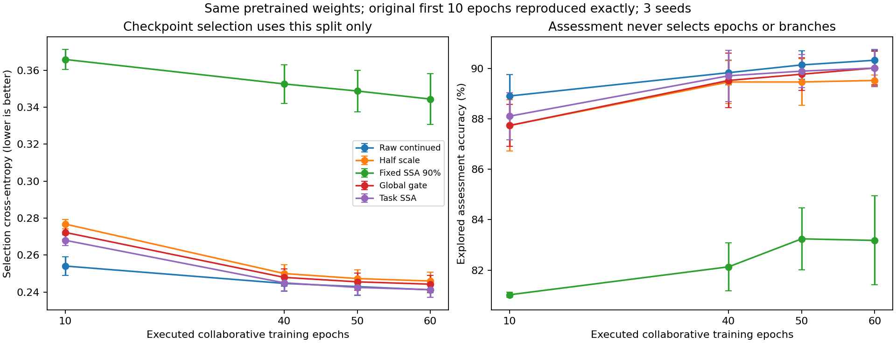

# 第十三轮：协同预算延长到50/60轮

## 预先锁定的设置

用户明确要求试验50轮与60轮。协议与执行代码在评分前提交为 `bc73eaa`，使用 `configs/classification_60_protocol.json`。本轮仅延长训练预算：三个种子42/43/44、原五个分支全部执行60轮，不按评价分数提前停止。

保留FordA官方TRAIN的2520拟合/540选模/541内部评价划分；不加人工污染、不接SRD、不改CNN、SSA嵌入32及33成分、不改标准化与初始化。共同预训练40轮的模型直接复用，不重新预训练。

旧40轮实验未保存完整优化器slot状态，因此从同一预训练检查点重跑，保持原始10轮余弦调度，之后学习率保持0.0009。每轮40批，50轮为2000次、60轮为2400次分类器更新。学习头另有相同次数的头更新，不能把等分类器预算写成等计算量。

逐组检查10轮最佳权重/批次哈希与第十轮相同，并检查40轮最佳、实际终态权重及批次哈希与第十一轮相同。原来源文件保留不变。不是从旧selection最佳检查点重新启动优化器后称为连续延长。

保存10/40/50/60轮预算内selection CE最小的成对模型，并另存实际40/50/60轮终态。主比较仍为selection最佳模型，终态另报；所有训练结束后统一评分，不因某轮评价略胜改变报告规则。

## 结论边界

此前内部评价已被多次查看，本次用户提出预算延长也受此前结果启发，是探索性追加试验。50/60轮结果都报告，不用本轮评价成绩挑一个最有利轮数作为新的独立确认。官方TEST保持未下载/未读取。

即使某个预算的任务SSA准确率超过原始，也需看三个种子的配对差、缩放对照、样本净变化及代价。小幅反转不自动证明稳定泛化或物理去噪。不同预算内最小selection CE按定义不增加，不能单独用这个事实证明选择器有效。

此前40轮的冻结缩放替换诊断仍只约束原模型，不能自动把其+0.25个百分点转移为60轮模型已验证的成分编辑收益。本轮不追加新的缩放替换或成分标签实验，不自动继续训练超过60轮。

## 60轮主运行

15个分支均完成60轮、2400次分类器更新。三个原始输入分支的最佳轮次为54/55/51，任务SSA为58/55/56；所有模型都完成60轮，最佳轮次较早并非提前停止。

60轮预算内由selection CE选出的模型，内部评价平均准确率为：原始90.33%±0.38%、任务SSA90.02%±0.74%、学习全局缩放90.02%、固定半缩放89.53%、固定SSA83.18%。标准差为三个训练种子的样本标准差。

| 种子 | 原始准确率% | 任务SSA准确率% | 任务−原始，百分点 |
|---|---:|---:|---:|
| 42 | 90.02 | 90.02 | 0.00 |
| 43 | 90.20 | 89.28 | −0.92 |
| 44 | 90.76 | 90.76 | 0.00 |

对应任务相对原始净多判对0/−5/0个样本，平均低0.31个百分点。任务和学习全局缩放平均准确率恰好相同，但不意味着它们逐样本预测相同。任务评价CE0.24970仍低于全局缩放0.25623，但高于原始0.24772，不能只以某一相同比例断言成分编辑完全无效。

与40轮相比，任务准确率89.71%→90.02%提高0.31个百分点，原始89.83%→90.33%提高0.49个百分点。任务自身提高并未转化为超过同预算原始输入的收益；任务−原始从−0.12变为−0.31个百分点，不能沿着10→40轮的差距缩小趋势直接推断继续训练会追上。

主运行耗时1722.68秒（约28.7分钟），复用预训练及SSA缓存，CPU/TensorFlow2.14.0/NumPy1.26.4、数值线程1。41项既有检查通过；15组旧10轮最佳与旧40轮最佳/终态权重及批次摘要均复现。旧10轮来源88文件、旧40轮来源164文件均未变。

## 40/50/60轮预算的完整比较

以下均按selection CE选模型，数值为三个种子的内部评价平均准确率%。

| 方法 | 40轮 | 50轮 | 60轮 |
|---|---:|---:|---:|
| 原始继续训练 | 89.83 | 90.14 | 90.33 |
| 固定0.5缩放 | 89.46 | 89.46 | 89.53 |
| 固定SSA：90%轨迹能量 | 82.13 | 83.24 | 83.18 |
| 学习全局缩放 | 89.53 | 89.77 | 90.02 |
| 任务加权SSA | 89.71 | 89.90 | 90.02 |
| 任务−原始，百分点 | −0.12 | −0.25 | −0.31 |

50轮时，任务SSA相对原始的三个种子差异为−0.18/−0.37/−0.18个百分点，即净少判对1/2/1个样本。不能只把接近90%的绝对准确率当成插件增量。60轮有两次持平、一次较差；种子42任务/原始的541条类别预测全部相同，种子44虽判对数量相同，仍各有一条互相纠正的样本。



图中误差线是三个训练种子的样本标准差，准确率轴局部放大；横轴10→40间隔长，未绘制的20/30轮不能误读为本轮新增评分。旧20/30轮记录仍见第十一轮。

## 真实终态另报

| 真实轮次 | 原始准确率% | 任务SSA准确率% | 任务−原始，百分点 |
|---|---:|---:|---:|
| 第40轮 | 88.48 | 88.60 | +0.12 |
| 第50轮 | 89.46 | 89.46 | 0.00 |
| 第60轮 | 89.83 | 89.71 | −0.12 |

真实第50轮任务−原始为+0.18/0.00/−0.18个百分点，真实第60轮为−0.37/+0.18/−0.18，均不稳定。保留真实终态和选模结果，不因口径变化出现局部反转就更换主要结论。终态CE与准确率可不同步，不用评价CE反选模型。

## 核验与下一步

预算分析独立重载105个检查点状态、核对240组划分评分，旧10轮与旧40轮最佳模型预测均复现，60轮最佳预测与主运行一致。另独立重载18个最终保存模型、核对54组划分预测与指标，均通过；来源运行文件均未变。没有新增用于评分之外的神经训练或打开官方TEST。

本轮不支持“只要继续增加轮数就能超过原始”的判断，也没有证明60轮已完全收敛。建议在当前配置停止自动追加预算，先回到已经提出的成分诊断：权重究竟区分哪些成分、这些成分是否更有类别信息。若需修改架构或损失，另立单一假设、预先固定预算并重训全部匹配对照；本轮未执行这些后续设想。

## 复现

```powershell
python scripts/run_classification.py --protocol configs/classification_60_protocol.json --out runs/classification_60_new
python scripts/analyze_classification_budget.py --run runs/classification_60_new --out runs/classification_60_new_budget_analysis
python scripts/verify_classification.py --run runs/classification_60_new --out runs/classification_60_new_verification
```

协议依赖本地 `runs/classification_initial/` 的共同预训练权重、`runs/classification_40_initial/` 的前缀核对材料及FordA TRAIN。数据、缓存、权重不进入GitHub。新目录不覆盖历史运行。
