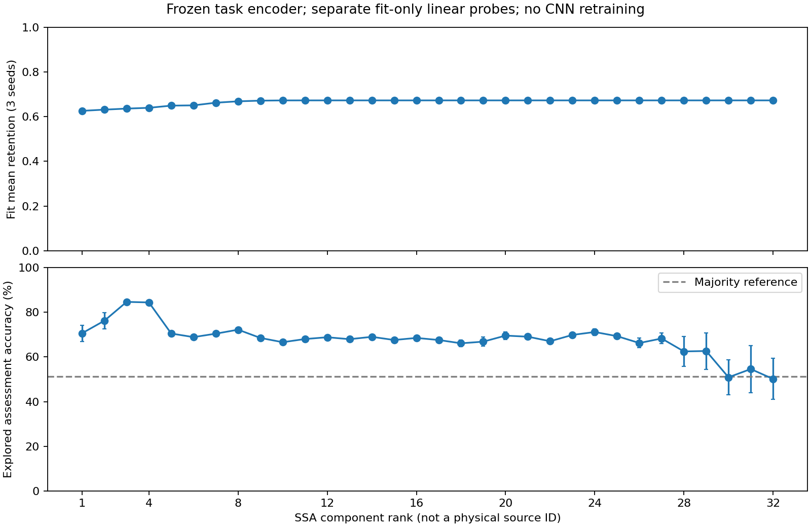

# 第十四轮：协同优化核验与SSA成分调查

有真实的协同优化；当前负结果不能解释为选择器没有获得下游监督。调查更具体地定位到：选择器对小幅值成分给出近似固定响应，权重没有呈现“单成分线性可分类性越高，保留越多”的简单关系。幅值依赖、选择头约束及特征适配值得做单因素实验，但本轮没有证明唯一失败原因。

## 协同部分到底做了什么

源码 `ssa_task_srd/classification.py` 的 `selector_step` 和 `train_branch` 实现：

1. 用共享CNN提取每个成分的特征，经sigmoid头给出权重并重构，计算分类CE。只更新选择头，分类器和共享特征参数不更新。
2. 对缓存的本批重构再次计算分类CE，更新分类器及其共享CNN，选择头不更新。缓存取自头更新前，本点与此前核对的本地TASK交替实现一致，不把它当成新发现的缺陷。
3. 下一个批次的选择器使用已经更新的共享CNN。按selection CE恢复同一轮的分类器与头，不各选各的最佳状态。

三个60轮分支均实际执行2400次选择头更新和2400次分类器更新。已有首批审计确认两阶段参数隔离、选择头确实变化、分类器确实变化、重构缓存一致。本轮另比较共同预训练与所选模型：共享编码器参数L2变化3.409/3.611/3.740；选择头参数变化1.449/1.501/1.376。这个头变化也包含初期max-norm投影，不能全解释为标签驱动效果。

本轮在选定权重上重新计算拟合前64条的选择头CE梯度，范数0.1558/0.1623/0.1830，均非零。只计算梯度，不调用优化器。梯度和参数变化不等于模型已有效收敛，但足以排除“代码完全没把分类损失传给选择头”的说法。已有实际更新审计只针对首批隔离，更新总数另由优化器迭代计数确认，不声称逐批保存了全部隔离快照。

## 调查规则与范围

评分前提交 `024cd39`，协议为 `configs/classification_component_audit.json`，原运行是 `runs/classification_60_initial/`。使用三个60轮预算内selection最佳模型，无新CNN或选择头训练、无检查点重选。逐种子重载后，重构预测与原logits复现，实际权重及来源195个文件保持不变。

记录33个成分（32个SSA成分+数值残差）的权重及RMS。RMS只表示幅值，不把成分平方和当成可相加的原信号能量份额，因为重构成分不保证时间域正交。

对32个SSA成分以及原始输入，提取冻结任务CNN的32维特征。每个表示独立拟合一个StandardScaler和固定C=1的逻辑回归，全部只用2520条拟合样本，不调超参数；另报告540条selection、541条内部评价。共99个小型线性探测分类器、297组划分评分，全部收敛。数值残差约1.39×10⁻¹⁵ RMS，不训练它的分类探测器，避免放大数值误差。

这些探测器衡量的是**当前学习特征中的线性类别信息**，不是每个原始成分的全部信息；也不是原CNN直接单成分推理。全流程仍依赖任务标签，不能称无监督。内部评价此前已多次探索，官方TEST未使用。

## 权重具体分给了谁

以下为三个种子的均值：权重和RMS取拟合段，线性探测准确率取内部评价。

| SSA成分 | 平均保留权重 | 成分RMS | 线性探测准确率% |
|---|---:|---:|---:|
| C1 | 0.626 | 0.46286 | 70.61 |
| C2 | 0.632 | 0.37399 | 76.22 |
| C3 | 0.636 | 0.17197 | 84.66 |
| C4 | 0.640 | 0.14736 | 84.41 |
| C8 | 0.669 | 0.03245 | 72.21 |
| C10 | 0.673 | 0.00524 | 66.61 |
| C20 | 0.673 | 0.00049 | 69.56 |
| C30 | 0.673 | 0.00023 | 50.89 |
| C32 | 0.673 | 0.00022 | 50.15 |

评价多数类参考为51.20%。原始输入的同类冻结特征线性探测平均90.33%，这是额外训练的小探测器，不是原任务CNN89/90%结果的直接替代，也不能与原始继续训练CNN作为完全同架构比较。



图中每个成分的评价误差线为三个训练种子的样本标准差。组件编号表示每条样本SSA奇异值排序，不代表跨样本严格一致的物理源；一个振荡可拆为成分对。

关键现象：C3/C4在此探测中比C30/C32可分类得多，却没有更高的平均保留权重。不能把这个现象直接判成“学反了”：联合重构时有冗余、互补和相消，单成分准确率不能决定最优联合权重，也不能据此安全删掉某个成分。后段探测前有特征标准化，会放大小幅变化，对极弱成分的表现还需防范浮点精度和特征偏移影响；不把它们全称为真实生理/物理信号。

## 接近零的成分为什么仍得到约0.67权重

对冻结选择器输入真正的全零成分，输出保留权重为0.65951/0.69905/0.66061。各种子C10至C32的拟合平均权重与这个值的最大绝对偏差仅0.000135/0.000084/0.000220。这确认了当前弱成分权重接近该模型的零输入响应，并不表示模型有证据判它们“更干净”。CNN含偏置，零输入经过共享特征不一定得到零向量；所以也不能只用sigmoid头的偏置值预测最终零输入权重。

选择头核范数三个种子都为0.25，达到既定max-norm上限；同一样本各成分权重的平均标准差约0.0167/0.0149/0.0134。sigmoid输入的样本内成分标准差约0.0717/0.0679/0.0577，当前权重区分幅度较小。约束处于边界值得检查，但“达到上限”不证明解除约束一定改善泛化。

权重与成分RMS跨32个序号的初始Spearman相关约−0.89/−0.92/−0.79，说明幅值关系明显；这仍是观察关系，不代表幅值是唯一决定因素。

初版权重与探测准确率的原始秩相关为负，但尾部权重几乎相同，浮点求均值的不同累加顺序会改变其极小差异的排序。因此补做独立事后数值核验，不覆盖原记录：float64求均值后相关为−0.632/−0.578/−0.613；权重四舍五入至10⁻⁴、近似相等者作并列秩后仍为−0.543/−0.636/−0.608。该精度规则是看到平台后追加，不能称预先锁定；相关仅描述，不用p值宣称显著，不把负相关直接当成选择错误的因果证明。

## 为什么没有超过原始输入：目前能说到哪里

- 已确认不是缺少分类反馈，或只更新头而从未更新共享特征。
- 有成分类别信息，但当前权重明显受幅值影响，弱成分进入近似固定响应区。它没有表现出预期的简单信息排序；这比“轮数太少”的猜测更具体。
- 单个权重较大不表示该成分主导重构。弱成分幅值太小，较大的保留系数也可能几乎不影响合成；结合已有重构几何可知，主行为仍接近整体缩放，含少量形状编辑。不能把权重表直接当成成分实际贡献表。
- 当前60轮原始输入90.33%、任务SSA90.02%的差距很小且来自少数样本，不能由本轮唯一归因给约束、CNN结构或数据噪声量。原始观测没有干净参考，当前也未证明有可剔除且任务无关的噪声。

下一步建议只检验一个因素：**选择器看每个成分时，先按各自RMS规范化；真正重构仍用原幅值成分。** 保持共享CNN、头约束、重构与下游分类器形式不变，为零/极弱成分预先固定数值下限；所有对照仍匹配预算。它能检验幅值是否妨碍权重区分，但也可能丢掉有用幅值信息或放大数值误差，不能预承诺改善。本轮没有实施这个修改或训练，不同时解除约束、增加CNN层或重新加噪。

## 工程与复现

主诊断耗时25.75秒，主运行目录 `runs/classification_component_audit_initial/`。零输入和近似并列秩补充为 `runs/classification_component_audit_followup/`，是看到主诊断后追加的描述检查，不更改主评分。原始权重/特征保留本地，代码、小型CSV和图进入GitHub。

```powershell
python scripts/audit_classification_components.py --out runs/classification_component_audit_new
python scripts/summarize_component_audit.py --run runs/classification_component_audit_new --out runs/classification_component_audit_new_followup
```
