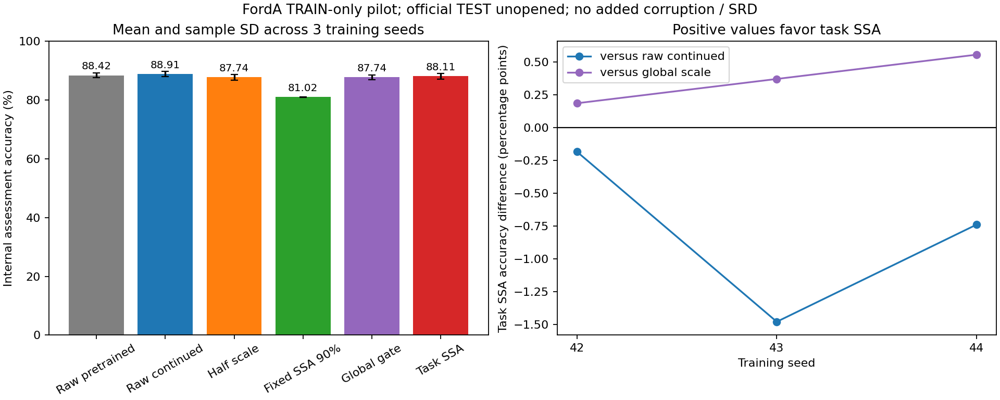

# FordA 原始单变量分类：第十轮受控探索

## 问题与结论

用户要求检验分类是否比预测更适合TASK式SSA选择。已完成分类交叉熵驱动的选择器/分类器交替训练，三个共同预训练和15个匹配分支。当前配置未获增量：任务SSA评价准确率88.11%，同预算原始分类器88.91%，三个种子均低于原始分类器。任务SSA明显优于固定SSA，但不能把这一点写成比不处理更有效。

本轮同时换了数据、任务和下游结构，不能把与此前Tetouan的差异单独归因于“分类比预测好/坏”；也不能据此认定所有分类数据上的SSA都无效。该组合仍是探索方案，不是已确认论文创新或去噪成功。

## 运行前规则与来源

- 协议及执行代码先提交为 `7bc05dc61eaed4aebda218fbe3a63e95d887d992`；配置为 `configs/classification_protocol.json`。
- 数据：[FordA官方说明](https://timeseriesclassification.com/description.php?Dataset=FordA)。下载地址采用[官方Keras示例](https://keras.io/examples/timeseries/timeseries_classification_from_scratch/)链接的公开镜像，只下载 `FordA_TRAIN.tsv`。
- SHA256：`f80f6df3336194b2d52bb29fc41c980e7f0a809c80a5c5b79121d74622e0a7de`，20,094,049字节，3601条×500点，标签-1/1映射0/1。类别含义是汽车子系统某种症状是否存在。
- 官方说明FordA污染较少；不能预设它一定有可删除的有害噪声。类别相关的故障波形应保留，不能把“异常类别”直接当测量错误。
- 只用官方TRAIN，固定分层划分种子20261020：2520拟合、540选择、541内部评价。各类计数依次为[1292,1228]、[277,263]、[277,264]。无完全重复波形跨划分；没有受试者/设备组ID，不声称组间泛化。官方TEST没有下载或读取。
- 全局输入均值/标准差仅由拟合输入计算；不对每个分支的重构单独重新标准化。SSA为逐样本无标签处理，不混合不同样本。
- SSA嵌入32，全部32个基本重构成分+精确残差进入学习选择。固定SSA取最小前缀使轨迹矩阵奇异值平方累计能量≥90%，三个划分的中位保留阶数均为4，拟合范围2–7。90%指轨迹矩阵能量，不直接等同于重构序列解释90%方差。窗口32和阈值90%都是预算/基线设置，没有证明最优。
- 分类器为小型1D-CNN：Conv(8,7,stride2,ELU)→Conv(32,5,stride2,ELU)→GAP32→二分类logits，共1442参数，没有BN/Dropout。它没有复现Keras示例较大的FCN，也不是原TASK的EEGNet。
- 每种子42/43/44先共同预训练最多40轮，选择CE早停耐心10；五个分支复制相同预训练权重。分支固定10轮、批量64，每组400次分类器更新；批次顺序、优化器、学习率计划和选择检查点预算相同。任务头33参数/全局头1参数各增加400次头更新；不是相同FLOPs。
- 选择器阶段只更新保留头，分类器阶段用选择头更新前缓存的重构更新共享特征及分类头。使用分类CE，不使用预测MSE、干净参考或SRD梯度。选择最小selection CE，包含epoch0，并成对恢复分类器+头。
- 所有预定训练结束后才评分内部评价集。结果不用于本轮改结构、换种子、调阈值或重选轮次；这些模型选定后，评价集即已被使用，后续不可继续称为未观察留出集。

## 内部评价结果

均值±样本标准差来自三个训练种子，不是三个独立数据集。准确率、平衡准确率和macro-F1越高越好，CE越低越好。

| 方法 | 准确率% | 平衡准确率% | macro-F1 | CE |
|---|---:|---:|---:|---:|
| 原始预训练 | 88.42±0.77 | 88.42 | 0.8841 | 0.2729 |
| 原始继续训练 | **88.91±0.85** | **88.93** | **0.8891** | **0.2682** |
| 固定乘0.5继续训练 | 87.74±1.02 | 87.71 | 0.8771 | 0.2838 |
| 固定SSA能量前缀 | 81.02±0.11 | 81.02 | 0.8102 | 0.3797 |
| 学习全局缩放 | 87.74±0.83 | 87.71 | 0.8771 | 0.2803 |
| TASK式完整SSA加权 | 88.11±0.93 | 88.11 | 0.8809 | 0.2765 |

拟合段多数类常量预测的评价准确率为51.20%。其日志中CE来自任意固定logit的常量输出，不作为校准概率基线或排名依据。

| 种子 | 原始继续训练% | 任务SSA% | 任务−原始，百分点 | 任务−全局缩放，百分点 |
|---|---:|---:|---:|---:|
| 42 | 88.17 | 87.99 | -0.18 | +0.18 |
| 43 | 88.72 | 87.25 | -1.48 | +0.37 |
| 44 | 89.83 | 89.09 | -0.74 | +0.55 |

平均任务−原始为-0.80个百分点，任务−全局为+0.37个百分点。541个评价样本中，一个样本就对应0.185个百分点；与全局对照的优势分别只相当于净多判对1/2/3个样本，不能据三个训练种子直接宣称统计显著或稳定泛化。



## 怎么解释

1. **分类驱动机制确实已经运行。** 分类损失能更新保留头，交替更新阶段隔离通过；不能用负结果解释成还没实现下游驱动。
2. **任务SSA比固定能量截断好，但仍比原始输入差。** 说明当前学习重构比这条固定规则损伤小，尚未证明“处理有收益”。固定规则可能去掉了低能量判别信息，也可能有截断边界/适配预算等影响，本轮未通过单因素实验区分，不能把所有被删成分直接认定为噪声。
3. **差异不是只出现在评价集。** 原始/任务的平均拟合准确率90.16%/89.67%，选择89.32%/88.83%，评价88.91%/88.11%。目前没有证据把主要原因直接归为只在评价集过拟合或分布突变。
4. **仍需区分成分编辑和整体幅值。** 任务平均保留概率约0.588–0.632，成分权重的平均样本内标准差约0.010；学习全局缩放约0.532–0.562。任务略优于全局对照，不自动证明不同成分的选择有效，整体尺度不同仍可能贡献这一差异。权重统计未按成分能量加权，尤其不能用大量弱成分的近似相等权重断言网络完全没有成分选择。
5. **原始信号没有干净参考。** 分类改善和物理去噪是两件事；本轮甚至尚未超过不处理，不报告去噪成功。

## 成本、核验与复现

主运行 `runs/classification_initial/`，约243.80秒（约4.1分钟），CPU、TensorFlow2.14.0、NumPy1.26.4、数值线程1。任务分支平均约42.70秒；原始继续训练约2.63秒，约16.2倍。该比值只描述本机本轮包含编译/选择评价的墙钟时间，不是普适复杂度结论。存储/算力随样本和SSA成分数增加，保留头参数数目保持33。

40项检查通过，包括分类CE梯度、阶段隔离、预算匹配、成对检查点、固定能量规则、SSA完整重构及既有预测/Java检查。主运行已保存18个模型和全部划分logits，重新加载后核对15个训练分支的选择预测与权重摘要；另外进行完整的18模型独立复核，记录见 `results/classification/all_checkpoint_checks.csv`。

后续核验与几何统计单列为 `runs/classification_verification/`。几何统计只计算重构与每条原始信号最接近的整体缩放差别，没有训练新模型，也没有评价“缩放替代输入”的分类器；不能把它当成已完成的成分选择贡献实验。源运行文件保持原样。

几何描述中，三个种子的评价重构与每样本最接近整体缩放之差的RMS，分别为原始输入RMS的0.626%、0.682%、0.687%。重构在数值上很接近整体缩放，但这一小部分形状差异对分类究竟有利还是有害，仍需下一步同分类器替代诊断。公开图另导出为0–100%的完整准确率轴，原核验目录中的初始图保留不覆盖。

```powershell
./scripts/run.ps1 -Mode tests
# 网络可用时先下载唯一的TRAIN文件；已有文件只校验/记录，不覆盖。
& 'D:/cjx/paperstudy/eegdenoise/.venv/Scripts/python.exe' -X utf8 scripts/fetch_forda.py
./scripts/run.ps1 -Mode classification -Out runs/classification_new
& 'D:/cjx/paperstudy/eegdenoise/.venv/Scripts/python.exe' -X utf8 scripts/verify_classification.py --run runs/classification_new --out runs/classification_new_verification
```

## 下一小步及判据（尚未执行）

先不继续改网络或接SRD。冻结这三个分类模型，将各样本任务重构替换为“最接近它的原始信号×一个系数”，使用同一分类器比较。系数只由当前原始信号和已有重构求出，不使用类别标签；先锁规则再算分数。

- 两者接近：当前效果可能主要来自尺度，成分编辑尚无明显增量。
- 任务重构更好：存在对该固定分类器有用的成分编辑，但仍要解释为什么没有超过原始继续训练。
- 整体缩放更好：当前成分编辑可能损伤判别信息。

这是冻结模型的事后诊断，输入替代也会改变分类器的输入分布，不能单独确认真实噪声身份或因果机制。此前预测分支拟议的同类诊断尚未执行，本轮不登记它的结果。若诊断仍不支持成分选择，不继续围绕当前配置追分；在有明确干扰来源的数据上重新提出假设后，再决定是否扩展第二个分类集。
