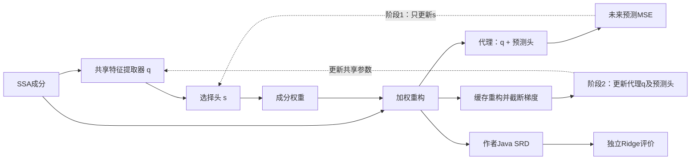
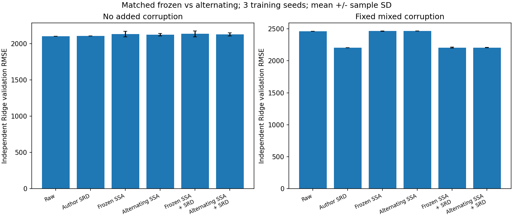
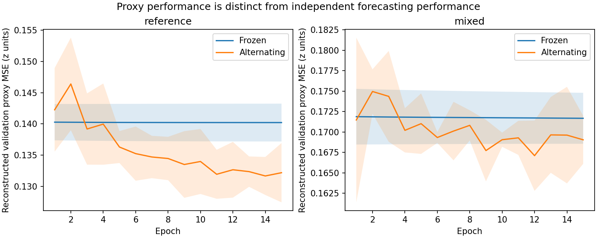

# 第四轮：TASK 式协同优化与匹配冻结对照

已将选择器／代理的交替更新机制迁移到当前 SSA 预测框架，完成12次真实数据验证运行和19项检查。协同训练确实改善代理自身的预测，但没有给独立 Ridge 或完整串联带来稳定增益。本轮保留这些负结果，不将代理成绩提升直接解释为去噪成功。

执行代码提交 `6da5b00`。运行前提交的协议：[collaborative_protocol.json](../configs/collaborative_protocol.json)。完整运行文件保留在本地 `runs/collaborative_initial/`，不覆盖前几轮。

## 这次补齐了什么

对照你本地 TASK 的 `base_classes.py::Component_selection_sigmoid.train_step`，落实以下核心机制：

1. 先预训练任务代理，获得共享任务特征。
2. 每批先用重构后的预测误差更新选择器权重头；此阶段代理和共享特征不更新。
3. 协同组再用重构数据更新代理，连同共享特征一起更新；选择器权重头保持不变。
4. 第二阶段使用第一阶段生成、权重头更新前缓存的重构，并显式截断其梯度，与检查到的 TASK 代码复用 `X_recons` 的顺序对应。
5. 验证时使用当前共享特征重新生成权重，按验证误差选择检查点，一起恢复代理和选择头。



`q`在成分打分和代理预测中是同一组参数，不是两份复制网络。选择阶段仅更新33个头参数；协同代理阶段更新18,608个代理参数，其中13,856个是共享特征参数。总共18,641个不重复神经网络参数，参数个数不随窗口数量增加。

**这实现了协同优化机制的预测迁移，不是完整 EEG TASK 复现。** 仍使用单变量 SSA、MLP、预测MSE、偏向保留的初始化偏置4和人工污染前历史预训练，未采用原 EEGNet、分类交叉熵及原代码全部约束设置。Java修复仍在神经网络训练之后，不参与反向传播。

## 如何避免把其他改动算作协同收益

本轮重新训练匹配冻结组，而没有直接拿上一轮2197.54等单种子成绩当唯一对照。

| 设置 | 匹配冻结组 paired_frozen | 协同组 collaborative |
|---|---|---|
| 代理结构、预训练及初始权重 | 同一设置、同种子逐参数相同 | 相同 |
| 选择头结构及初始权重 | 32维特征、33参数、偏置4、初始化种子731 | 相同 |
| 批次顺序 | 同种子完全相同 | 相同 |
| 选择头更新 | 固定15轮，每轮5批，共75步 | 同样75步 |
| 代理继续更新 | 0步 | 每批追加1步，共75步 |
| 优化器 | AdamW、AMSGrad、weight decay .004、余弦末端比例.9、梯度全局裁剪1 | 相同设置，代理另设独立优化器 |
| 检查点 | 第1–15轮中重构验证代理MSE最低的一轮 | 同规则，同时恢复代理与头 |
| Java SRD | 已核验作者版本，k=6，最多5轮 | 相同 |
| 最终预测器 | 处理后训练历史分别拟合独立Ridge，alpha=1 | 相同 |

旧 `legacy_frozen` 使用Adam与早停，其优化器、批次调度及预算与本轮不同，保留为历史结果，不能把跨轮差异全部归因于协同。新冻结对照的代理虽然允许图中求导，但只有选择头被优化；代理参数在完整训练后逐位不变。

协同组增加了代理更新，计算预算并非与冻结组严格相等；这是当前对训练机制的比较。两组选择头看到相同数量、相同顺序的批次，时间单独记录。

## 数据和评价范围

- Tetouan Zone 1，过去432点（三天）预测144点（一天），原有时间划分与训练段标准化不变。
- 每次36个训练窗口、12个验证窗口；未构造测试窗口或评价测试集。
- 两种输入：原观测不再额外污染；固定种子42的高斯噪声及局部错误。
- 三个训练种子42/43/44，反映初始化和训练随机性；不是三次不同污染实现。
- 2条件×3种子×2机制＝12次运行；每次六条处理路线，共72行指标。
- 代理的重构验证MSE用于选检查点；独立Ridge成绩不参与选轮次、训练或参数更新。

## 独立预测器结果

以下为3个训练种子的均值 ± 样本标准差，原单位的预测RMSE越低越好。固定方法在共同数据上结果一致，不显示±0。

| 路线 | 无额外污染 | 人工污染 |
|---|---:|---:|
| 不处理 | 2102.49 | 2461.02 |
| 单独作者SRD，k=6 | 2106.72 | 2205.60 |
| 固定SSA | 2493.18 | 3078.19 |
| 固定SSA → SRD | 2493.18 | 3078.19 |
| 匹配冻结任务SSA | 2129.91 ± 39.41 | 2465.74 ± 2.23 |
| 协同任务SSA | 2122.80 ± 18.31 | 2466.73 ± 1.68 |
| 匹配冻结任务SSA → SRD | 2134.74 ± 40.18 | 2206.10 ± 7.38 |
| 协同任务SSA → SRD | 2126.91 ± 19.55 | 2206.80 ± 2.48 |

污染条件下，完整协同组合比匹配冻结组平均高0.70个RMSE单位，即略差。三种子的配对差为 `[+6.87, -3.94, -0.82]`，配对标准差5.57，协同赢两次但均值没有改善。**不能以“赢两次”宣称有效，更不能以只有种子42或某一轮的成绩选择性报告。**

无额外污染时，协同组合比冻结组合平均低7.83，但配对差为 `[-31.65, +3.80, +4.36]`，改善由一个种子主导；三个种子中仅赢一次。它仍比不处理的2102.49更差。

污染条件下，单独作者SRD为2205.60，两种任务组合均未获得稳定增量。当前版本的任务SSA单独使用也未优于污染输入直接预测。

## 代理自身确实改善了

以下是各种子按自身验证集选定检查点后的重构代理MSE均值，使用标准化单位；不是上述独立Ridge的原单位RMSE。

| 条件 | 匹配冻结 | 协同 |
|---|---:|---:|
| 无额外污染 | 0.140171 | 0.130428 |
| 人工污染 | 0.171626 | 0.164106 |

这说明代理继续训练产生了有效的预测适应，但独立模型没有同步受益。现有证据不能区分代理单独适应的贡献与更好重构的贡献，也不能据此声称恢复了真实干净信号。

验证窗口中的成分权重总体仍接近保留输入。污染条件下，窗口内成分权重标准差的种子均值：训练前两组均为0.007791；训练后冻结组0.007802，协同组0.008246。它们没有形成大幅抑制某些成分的行为。权重不同或变化更大本身都不是有效去噪的充分证据。

训练曲线展示每一轮的实际验证值及种子间标准差；结果表使用各个种子分别选中的最佳检查点。因此“平均曲线某一轮”与“每个种子的最佳轮次平均”不是同一个数值。

## 检查和审计

- 19项检查通过，新增4项覆盖：共享参数对象身份与参数组互斥；选择器阶段只改头、返回更新前缓存；代理阶段改共享特征和预测头而不改头；同时恢复两部分能恢复原输出。
- 每次首批训练额外保存参数快照，核对两阶段隔离；最终核对冻结组代理不变、协同组共享特征及代理发生变化。
- 12次运行的配对初始代理哈希、初始选择头哈希、全部批次顺序哈希、输入哈希及窗口位置一致，Java JAR和核验证书一致。
- 每组均有75次头更新；冻结组0次代理更新，协同组75次。15轮固定训练完后恢复验证最佳轮，并非按独立预测误差选检查点。
- 全部配对、冻结／更新、共同固定基线及无测试评价审计通过。
- 12次程序内部耗时合计约78.60秒，学习阶段约52.62秒。冻结学习平均约4.21秒、协同约4.56秒，仅对应本轮小样本CPU环境及SSA缓存；不作为普遍计算成本结论。

## 这轮能说明什么

1. 原先缺少的交替训练和共享特征更新已经真正实现，当前结果不再只代表旧冻结代理版本。
2. 在这套小数据、三周期历史、当前初始化和预测器设置下，协同没有解决插件的独立预测增量问题，也没有消除正常输入损伤。
3. 这不证明所有TASK迁移都无效，也不证明SSA永远无法帮助预测；不能从12个验证窗口推广到其他数据和模型。
4. 整个串联的训练损失仍在SRD之前计算，而实际独立预测发生在SRD之后。这是明确的设计边界，是后续可检查因素，不是已经确认的失败原因。
5. 验证集用于多轮探索和检查点选择，本轮不提供最终泛化结论；正式结果仍需要方案锁定后的留出评价。

## 下一小步

先做一个固定成分消融诊断，暂不继续增加网络：在相同SSA分解和Java SRD下，逐一去掉7组成分中的一组，比较独立预测误差。它用来检查当前分解是否显示出可利用的成分选择空间，不把验证集上挑出的最好消融当成正式方法。

- 若某组成分去掉后在验证集明显更好：说明当前分解有进一步学习选择的线索，应检查选择器目标和特征。
- 若逐组去掉都无改善：说明简单删除一个成分的策略未显示价值；仍不能排除软权重或组合策略，但不应直接堆更复杂网络。

该诊断尚未执行。初始化、历史长度、代理独立续训对照等也都没有在本轮同时更改。

## 复跑及结果文件

```powershell
./scripts/run.ps1 -Mode collaborative
```

按固定协议重跑12次，每次保存新目录。汇总使用同一个Python环境：

```powershell
python scripts/summarize_collaborative_round.py --run runs/collaborative_initial --out docs/results/collaborative_recheck
```

- [逐次指标](results/collaborative/metrics.csv)、[均值与标准差](results/collaborative/summary.csv)
- [配对比较](results/collaborative/paired_comparisons.csv)、[相对单独SRD与不处理的增量](results/collaborative/plugin_increments.csv)
- [权重、代理、耗时诊断](results/collaborative/diagnostics.csv)、[逐轮记录](results/collaborative/epochs.csv)
- [配对及参数更新审计](results/collaborative/audit.json)




