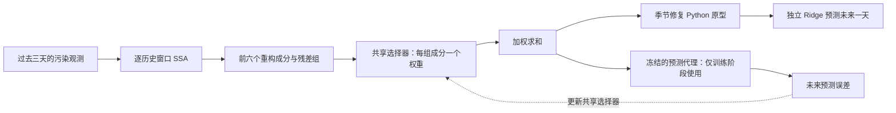

# 初步实验记录：2026-10-20

目标：先回答“SSA 分解 → 共享权重选择器 → 季节修复原型 → 独立预测器”能否运行，以及学习模块是否真的更新。此次完成工程验证；没有获得任务插件带来可靠增益的证据。

## 固定方案



代理先在原观测的训练历史上预训练；选择器用人工污染的历史训练。代理参数冻结，梯度经代理输入传回选择器。修复模块不参与反向传播。最终 Ridge 与代理是不同模型，每组分别在对应处理后的训练历史上拟合。

选择器只有 **161 个共享参数**，窗口越多不会增加参数个数；SSA 预计算、训练样本量和缓存会随窗口数量增长。本轮代理为 18,608 个参数。

## 数据与设置

- 公开来源：[UCI Tetouan 电力数据](https://archive.ics.uci.edu/dataset/849/power+consumption+of+tetouan+city)，下载后解析得到 52,416 行。使用 Zone 1 这一条序列。
- 时间范围：2017-01-01 00:00 至 2017-12-30 23:50，间隔 10 分钟；检查无缺失值、重复时间或不规则间隔。
- 按时间 70% / 15% / 15% 划分，标准化只使用训练段。只处理预测时刻之前的历史，目标不跨越各自划分边界。
- 输入 432 点（三天），预测 144 点（一天）；步长 144 点；SSA 轨迹矩阵 144×289，保留前六个单成分并附残差组。
- 本轮仅在各划分内均匀抽取 36 / 12 / 12 个训练、验证、测试窗口；并未使用所有可能窗口训练。
- 固定种子 42；在标准化序列上加标准差 0.1 的高斯噪声，以及起始率 0.003、持续 3 点、幅值 ±3 的局部错误。起始率不是最终被污染点比例。所有方法共用同一污染时间线，重叠窗口不会反复重新加噪。
- 未来目标保持原观测。原观测是注入实验的相对参考，不代表绝对干净数据。
- 代理最多训练 25 轮、选择器 15 轮，使用验证集与早停；最终 Ridge 的 alpha 固定为 1，不依据测试成绩调参。

## 真实数据工程结果

以下为单种子、12 个测试窗口上的平均预测误差，越小越好，单位随原始 Zone 1 观测值。完整小数见本地 `runs/pilot_initial/metrics.csv`。

| 历史输入处理 | MAE | RMSE |
|---|---:|---:|
| 不处理 | 2106.79 | 2820.64 |
| 固定 SSA | 2595.93 | 3398.13 |
| 季节修复原型 | 1911.97 | 2578.35 |
| 固定 SSA → 修复原型 | 2151.61 | 2817.22 |
| 任务 SSA | 2107.08 | 2821.93 |
| 任务 SSA → 修复原型 | 1909.97 | 2577.05 |

完整组合相较单独修复的 RMSE 仅低约 **0.05%**。这没有重复种子或置信区间支持，不能作为有效增益。

固定 SSA 的历史重构 RMSE 从 0.3375 降至 0.2072（标准化单位），但预测 RMSE 反而变大。可以记录为“重构指标改善不保证预测改善”的本轮观察；不能据此证明其对所有数据都无效。

任务选择器的参数确实更新，代理参数保持不变。不过测试成分权重集中在 0.9716～0.9743，组间几乎相同；本轮更接近整体缩放，没有形成明显的成分选择。初始化偏向保留输入、训练规模小、选择器特征区分能力有限，都属于待检查原因，当前没有区分各自贡献。

## 检查与耗时

- 9 项检查全部通过，覆盖 SSA 可加重构、已知周期信号、训练段标准化、时间边界、未来数据隔离、修复输入不被原地修改、污染复现和训练梯度/参数冻结。
- 合成数据六组烟雾实验也通过，但任务 SSA 未优于固定 SSA；仅用于检查流程，不能挑选它来代替真实结果。
- 真实数据此次程序计时约 7.38 秒，其中首次 SSA 计算约 0.23 秒、学习阶段约 4.79 秒。外部进程总耗时约 9.42 秒。**仅对应 60 个窗口的 CPU 小试验**，不代表全量训练、调参或论文完成时间。
- 环境：Python 3.10.11，NumPy 1.26.4，SciPy 1.13.1，pandas 1.5.3，scikit-learn 1.5.1，Matplotlib 3.9.2，TensorFlow 2.14.0；TensorFlow 当前未识别到 GPU。
- 真实试验对应代码提交 `8ed292dee52f202272edb787442bca706fbe1228`。合成试验发生在首次提交前，属于同次搭建过程。

## 尚未回答的问题与下一小步

**下一次先补“无额外污染输入”的对照**，保持现有模型不变，只在训练/验证段检查三件事：原始输入能预测多好；清洗是否损坏正常变化；代理对污染的敏感程度。先补这个参照，再讨论修改选择器，避免同时改变多个部分。

| 后续观察 | 能支持的解释 | 不能直接推出的解释 |
|---|---|---|
| 处理后比不处理好，但不比单独修复好 | 修复模块可能承担主要收益 | SSA 插件有独立价值 |
| 历史重构更好，预测更差 | 两个目标在该设置下不一致 | 重构指标毫无价值 |
| 权重始终几乎相同 | 当前选择器未形成明显区分 | 所有任务 SSA 方案都无效 |
| 多种子、其他预测器上都有增益 | 值得进一步检验可迁移性 | 已经证明普适或具备论文创新 |

修复模块目前没有通过作者 Java 版本一致性校准；作者公开代码的修复机制与论文文字亦有差异，详见 `PROVENANCE.md`。后续正式对照必须先明确采用哪个版本。无污染条件、多种子、多污染类型、多预测器与更充分训练均未完成。

本轮测试作为工程探索，不用于后续超参数选择；正式报告需锁定方案，并组织未参与方案选择的留出评价。本次不做论文新颖性判断。

## 复查与重跑

在工程目录使用 PowerShell：

```powershell
./scripts/run.ps1 -Mode tests
./scripts/run.ps1 -Mode smoke
./scripts/run.ps1 -Mode pilot
```

每次默认生成新目录。已完成输出保留在 `runs/smoke_initial/` 和 `runs/pilot_initial/`，包括配置、审计、实际环境、训练曲线、成分权重、污染掩码和逐组预测。
