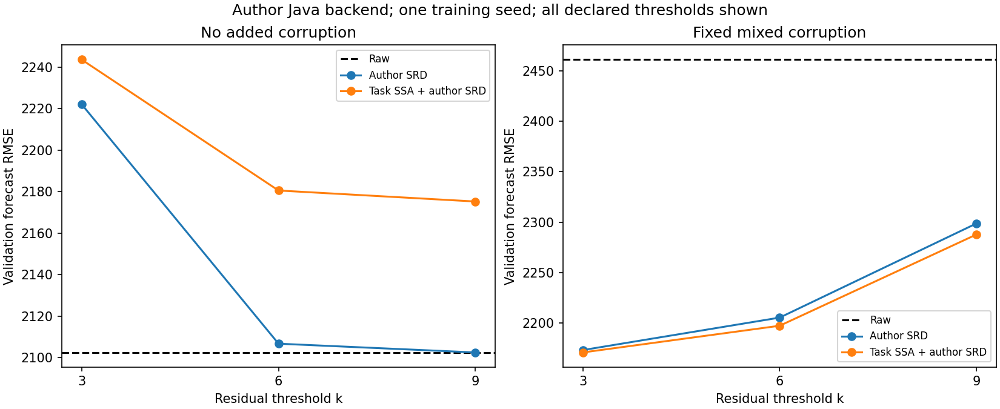

# 原版 Java SRD：环境、基线核验与框架接入记录

已完成：发现并配置本机现有工具链，原样构建作者工程，运行作者自带 smoke，验证 Python 批量接口逐点一致，运行三个固定真实配对案例，并接回现有 SSA／预测实验完成六组验证运行。以下不等同于完整复现论文所有表格。

## 环境检查与配置

`java`、`javac`、`mvn` 当时不在系统命令路径，`JAVA_HOME` 和 `MAVEN_HOME` 未配置。但在 IntelliJ IDEA 2025.2.5 安装目录找到可用工具：

| 工具 | 本机实际版本 | 使用方式 |
|---|---|---|
| Java / Javac | JetBrains JBR OpenJDK 21.0.9 | 复用 IDE 自带完整 JDK |
| Maven | Apache Maven 3.9.9 | 复用 IDE 自带 Maven |
| 作者编译目标 | Java release 17 | 保留作者 pom.xml 原设置 |
| Python | 原项目现有 3.10.11 环境 | 未安装或修改 Python 依赖 |

不需重新安装 JDK 或 Maven。项目配置写入被 Git 忽略的 `data/java/runtime.json`，启动程序按记录直接调用 Java，无需修改全局环境。Maven 依赖缓存限定在 `data/java/m2`，没有使用默认用户缓存作为写入目标。

初次沙箱构建因不能解析 Maven Central 域名失败，记录在 `runs/java_setup_initial/`；随后授权联网构建成功，完整记录在 `runs/java_setup_network/`。Maven 实际构建耗时约 54.23 秒，包含首次依赖下载，不是 SRD 算法运行时间。

## 作者版本及源码完整性

- 作者仓库：https://github.com/czjthss/SeasonalClean
- 固定提交：`84486b6c15e02f17ac32c80b827afb17e09802b9`
- 本地位置：`data/author/SeasonalClean/`，不进入本工程 Git。
- 原版 Maven 编译成功，生成作者可执行 JAR；作者受版本管理文件在构建前后均无改动。
- 本项目自己的 `java/SRDBridge.java` 仅负责输入输出，通过作者 JAR 直接调用 `Algorithm.SRD`，没有复制或重写 SRD 算法。
- 保存 JAR、适配器源码／字节码、作者各 Java 源文件及 pom.xml 的 SHA256。重新构建后必须重新核验接口，不能沿用不匹配的验证证书。
- 执行本轮六组预测实验的本工程提交为 `704048b`。

## 作者自带 smoke 与接口逐点核验

首先原样执行作者 JAR 的 `smoke` 命令。使用作者 `bank_1_7983.csv` 前2000点、作者 `LoadData` 和 `AddNoise`，种子666，周期288，k=6，最多5轮，其他加错参数也与作者命令一致。

| 作者 smoke 的修复指标 | RMSE |
|---|---:|
| 污染序列相对参考 | 0.235335 |
| 原版 SRD 修复后相对参考 | 0.068142 |

归一化后的修复 RMSE 降低约71.04%。此处衡量的是同一段数据修复后接近参考的程度，**不是未来预测误差**，不能与下面约2200的原单位预测 RMSE 数值比较。

使用本项目适配器再次生成完全相同的作者输入，再让 Python 批量接口传入该污染序列：

- 作者原始 smoke 输出与适配器生成的修复输出：最大绝对差 **0**。
- Python 批量调用与作者原始 smoke 输出：最大绝对差 **0**。
- 比较完整2000个双精度输出，不仅比较作者日志中保留三位小数的 RMSE。

旧 Python 原型在同一输入、周期、k和迭代数下，与作者 Java 输出的最大绝对差约0.441057，二者输出间 RMSE 约0.013710。因此旧原型成绩不能重新标注为原版 SRD；旧实现保留用于历史复查。

## 三个预先按名称选定的真实配对案例

统一使用作者真实配对读取方式、作者对应周期、k=9、最多5轮，只运行 SRD。作者 `LoadData` 对 clean/dirty 文件分别 min-max 归一化，本节沿用该方式以核对公开代码，未将这种做法用于后面的预测数据标准化。

| 文件 | 点数 | 污染 RMSE | 修复 RMSE | 说明 |
|---|---:|---:|---:|---|
| bank_1_7983 | 7983 | 0.005472 | 0.005472 | 当前阈值未触发修改，无提升 |
| grid_1_10108 | 10108 | 0.036078 | 0.012453 | 相对降低约65.48% |
| telecom_1_12672 | 12672 | 0 | 0 | 核对原始数值列也完全相同，不计为修复成功证据 |

保留所有选定案例，不只报告有改善的 Grid。此处不能宣称逐项复现论文表3：具体文件、集合和评价范围还需进一步对齐。

## 接回现有框架的方式


一个 Java 进程处理一批窗口，但每个窗口分别建立 SRD 实例。窗口不会拼接，修复也不读取窗口之后的观测。适配器不额外归一化；预测实验仍只用训练段计算标准化参数。输入输出使用双精度二进制，保存形状和文件哈希。

新后端明确选择 `repair_backend="java"`，方法标为 `srd_java`、`ssa_srd_java`、`task_ssa_srd_java`。Java 未配置、JAR/适配器哈希变化或未通过作者 smoke 核验时直接报错，不回退到 Python 原型。

SRD仍不参与反向传播：代理与SSA权重的训练方式不变。原型后端及旧配置保留，便于复查前两轮实验；新实验使用 `java_pilot` 或 `java_round`。

## 六组验证集运行

运行前固定 [协议](../configs/java_protocol.json)：2种输入条件×k为3/6/9，共6次。训练种子42、污染种子42、共享任务特征选择器、36个训练窗口和12个验证窗口，其余设置保持第二轮不变。未构造测试历史、未评价测试集。

每次均跑六条处理路线，全部36行指标见 [完整指标](results/java_baseline/forecast_metrics.csv)。主要结果如下，均为独立 Ridge 的验证预测 RMSE，越低越好：

| 处理 | 无额外污染 | 人工混合污染 |
|---|---:|---:|
| 不处理 | 2102.49 | 2461.02 |
| 作者 SRD，k=3 | 2222.02 | 2173.44 |
| 作者 SRD，k=6 | 2106.72 | 2205.60 |
| 作者 SRD，k=9 | 2102.49 | 2298.85 |
| 任务 SSA → 作者 SRD，k=3 | 2243.54 | 2171.09 |
| 任务 SSA → 作者 SRD，k=6 | 2180.50 | 2197.54 |
| 任务 SSA → 作者 SRD，k=9 | 2175.20 | 2287.92 |

全部阈值如实报告，不根据验证成绩反向将某一设置称为“论文默认最佳参数”。k=6是接入示例采用的作者合成实验设置，不是针对本轮成绩挑出的最优值。三周期历史仍是本工程场景，不等同于作者完整长序列实验。

### 正常输入为什么会变差：本轮增加的证据

在无额外污染的验证窗口中，k=3修改约2.08%的输入点；k=6没有修改验证输入，但修改了约0.0514%的训练输入；k=9没有修改这些训练和验证输入。改动统计以绝对变化大于1e-12计算。

因此k=6即使验证输入未变，最终预测仍可略有差异：Ridge是在处理后的训练历史上重新拟合，训练输入不同会改变模型。不能只查看验证窗口是否被修改。

这直接支持“阈值会影响本设置中对原观测的改动和预测结果”，但尚不能确定所有被改动的原观测都是正确值，也不能断言所有数据都应该采用k=9。

### SSA增量如何解释

人工污染下，完整组合相较单独SRD在k=3/6/9分别降低约2.35/8.06/10.93个RMSE单位。k=6的增量约0.37%，仅一个训练种子，仍不能认为具有稳定优势；无额外污染时，加入当前SSA插件依然会损害预测。

固定SSA及单独任务SSA的非修复成绩与第二轮种子42对应结果一致，预训练代理参数哈希也一致，因此没有在换Java后端时顺带改动任务模型训练。

## 检查与保存内容

- 15项检查全部通过，包括Java输入不原地修改、常量保留、窗口批处理互不影响、异常参数拒绝，以及原有时间边界与学习梯度检查。
- 作者原始smoke／独立fixture／Python批量调用逐点一致核验通过；配置包含匹配当前JAR与适配器的验证记录。
- 六次集成运行全部成功，均使用作者Java、验证证书通过、无测试评价。代理哈希相同且保持冻结；非修复路线与历史结果一致。
- PowerShell入口额外执行了 `java_pilot -FixedOnly`，确认用户入口可运行；这只是四条固定路线的入口检查，不计为新的独立实验。
- 作者工作副本最终仍无受版本管理文件改动。作者源码、JAR、原始配对数据、模型及逐点输出不上传；只提交本项目代码、小型汇总、哈希及记录。

小型结果目录：[环境与源码哈希](results/java_baseline/toolchain.json)、[作者核验](results/java_baseline/author_verification.json)、[基线修复指标](results/java_baseline/author_repair_metrics.csv)、[集成审计](results/java_baseline/integration_audit.json)、[改动比例](results/java_baseline/normal_input_changes.csv)、[旧原型同k比较](results/java_baseline/legacy_comparison_k3.csv)。

本地完整记录：

- `runs/java_setup_initial/`：首次网络受限构建记录。
- `runs/java_setup_network/`：成功构建日志和环境快照。
- `runs/java_verification_confirmed/`：作者smoke日志、配对输入输出和一致性核验。
- `runs/java_round_initial/`：六次完整配置、修复输入输出、模型、预测和审计。

## 复跑入口

在工程根目录使用现有Python环境，按顺序执行；每次默认创建新记录目录：

```powershell
./scripts/run.ps1 -Mode java_setup
./scripts/run.ps1 -Mode java_verify
./scripts/run.ps1 -Mode tests
./scripts/run.ps1 -Mode java_pilot
```

最后一条跑人工污染、k=6的单次接入示例。需要全部六组时改用 `./scripts/run.ps1 -Mode java_round`。`java_setup` 需要联网获取固定作者版本和Maven依赖；已存在工具链可自动发现，也可直接给 `setup_java.py` 指定 `--java-home`、`--maven-home`。

## 下一步范围

作者Java基线已跑通，且接口经逐点核验。下一步若继续研究插件增量，应保持Java后端和预先声明的设置，增加训练种子重复，并同时保留无额外污染条件；当前的小幅单种子增量不足以支持论文结论。历史长度、初始化及交替训练暂不同时修改。


