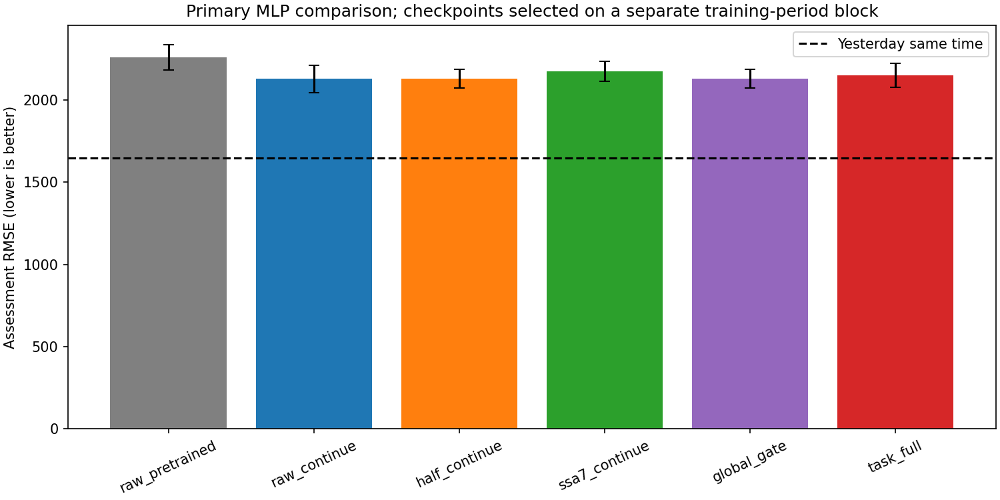

# 第九轮：把同一任务模型的受控收益作为主比较

用户确认应先验证“选择器＋MLP”相对“原始输入＋同预算MLP”的基本有效性，再考虑独立Ridge的迁移能力。该优先级已写入 [研究决策](RESEARCH_DECISIONS.md)、工程 `AGENTS.md` 和README，后续继续工作先读这些记录。

本轮实际完成三个共同MLP预训练、五类分支各三个种子，共15次分支训练。**全部主要成绩来自各分支配对训练的MLP，不运行独立Ridge。** 继续使用原始单变量数据，不加人工污染、不接SRD、不评价测试段。

结果：选择器＋MLP的平均RMSE为2148.83，同预算原始输入＋MLP为2127.25，任务选择器平均高约1.01%。三个种子仅一个略好，当前未显示稳定的额外预测收益。

## 本轮首先固定了什么

协议及源码在运行前提交为 `a6cef13`，见 [mlp_primary_protocol.json](../configs/mlp_primary_protocol.json)。

| 角色 | 窗口数 | 用途 |
|---|---:|---|
| 拟合 | 200 | MLP预训练与各分支梯度更新 |
| 选检查点 | 51 | 预训练早停、各分支选轮次 |
| 评价 | 54 | 选定模型后报告成绩，不参与本轮训练和选轮次 |

仍为过去432点预测未来144点、步长144。200/51来自原251个训练窗口的时间顺序划分；54个评价窗口为此前验证段。序列标准化只拟合前29232个原始观测，截止拟合段最后一个目标结束处，未使用选检查点或评价时段。

历史输入可包含此前已观测到的数据；各段未来目标不重叠、不跨边界。每个SSA只处理自己的历史窗口。评价段曾在历史轮次被探索，本轮不再用它选参数，但仍不称为新的独立确认集。

### 匹配的训练条件

- 每个种子只预训练一个432→32→144的MLP，隐藏层ELU，共18,608参数。最多25轮、早停patience=5，明确重载选检查点段损失最低的权重，并数值核验。
- 五个分支复制同一个种子的预训练权重，使用相同批次顺序、batch=8、代理优化器和15轮训练，每个分支均执行375次代理更新。
- 代理继续训练均为AdamW、weight decay .004、AMSGrad、余弦末端比例.9、梯度范数裁剪1。
- 所有分支都在第0–15轮中按选检查点段MSE取最好状态；即使最好为第0轮，也执行完整训练预算。任务分支共同恢复同一轮的代理与选择头。
- 任务分支另有375次选择头更新，比无头分支多计算及33个参数；学习全局尺度分支多1个参数。因此匹配的是代理更新预算，不声称总参数或FLOPs完全相等。
- 42/43/44三个种子全部报告；选择头核种子仍固定731，未覆盖所有头初始化随机性。

## 五个分支与参考基线

| 分支 | 输入处理与训练 |
|---|---|
| raw_continue | 原始输入，继续训练MLP，没有选择头 |
| half_continue | 原始输入固定乘0.5，再继续训练MLP |
| ssa7_continue | 固定SSA前七成分，再继续训练MLP |
| global_gate | 一个跨窗口、时间和成分共用的可学习sigmoid尺度，初始0.5；交替更新尺度与MLP |
| task_full | 全144个SSA单成分＋精确数值残差，共享MLP特征与33参数头；逐成分权重与MLP交替更新 |

另报告共同预训练模型直接预测，以及昨日同一时刻直接预测。前者没有额外训练预算，不能单独作为证明选择器有增量的对照；后者用于检查预测竞争力。

TASK式头采用零偏置、max-norm 0.25。选择阶段只更新头；代理阶段包括共享特征更新，复用选择头更新前的缓存重构，与已核对的本机TASK训练顺序相对应。

## 同模型主要结果

评价MAE/RMSE越低越好，均为原量纲。学习分支给出三个种子的均值±样本标准差，反映训练随机性，不是三个独立数据集。

| 方法 | 评价MAE | 评价RMSE |
|---|---:|---:|
| 只预训练的原始MLP | 1794.98±63.21 | 2258.86±78.46 |
| **原始输入，MLP同预算继续训练** | **1700.03±69.10** | **2127.25±83.76** |
| 固定0.5缩放＋MLP | 1687.21±42.47 | 2129.28±58.02 |
| 固定前七＋MLP | 1718.86±55.72 | 2172.40±60.98 |
| 学习全局尺度＋MLP | 1687.45±42.61 | 2129.21±58.17 |
| **任务选择器＋MLP** | **1700.16±49.17** | **2148.83±73.66** |
| 昨日同一时刻直接预测 | **1162.39** | **1647.79** |



三种子中，任务选择器相对同预算原始MLP的RMSE差为：

| 种子 | 任务选择器减去原始继续训练RMSE | 解释 |
|---|---:|---|
| 42 | −0.65 | 极小改善 |
| 43 | +19.75 | 变差 |
| 44 | +45.66 | 变差 |

均值为+21.59，配对样本标准差23.21。仅三个种子，不宣称任务选择器显著更差；可以判断的是当前没有稳定增量。

完整逐次数据：[metrics.csv](results/mlp_primary/metrics.csv)、[summary.csv](results/mlp_primary/summary.csv)、[配对差异](results/mlp_primary/paired_differences.csv)、[逐窗口误差](results/mlp_primary/per_window_metrics.csv)。

## 如何解释

### 预训练后变好主要需要先排除继续训练

原始MLP继续训练相对预训练参考改善约5.83%；任务选择器＋MLP改善约4.87%。因此不能只比较任务模型与预训练状态，便把改善算作去噪收益。本轮主要比较直接使用相同代理更新预算的原始输入分支。

### 更换为同模型评价后，当前增量仍未出现

这次没有跨模型迁移要求，也没有用独立Ridge的偏好衡量MLP指导出的处理。主比较仍未显示稳定收益，说明本轮负结果不能归因于MLP与Ridge不一致。它只对应当前数据、划分、MLP与选择器设置，不否定所有TASK式方法。

### 缩放与成分筛选应继续分开解释

固定0.5缩放、学习一个全局尺度的平均RMSE均约2129，与原始继续训练2127接近。任务成分选择没有稳定超过这两种简单处理。各机制对照也不能仅凭一个种子赢了就宣布成功。

### 当前重构接近整体缩放，但有一定形状变化

事后仅为描述重构，用拟合窗口确定最接近重构的常数倍s，不使用未来标签或评价成绩选s。三个种子的s约0.495、0.471、0.517。评价重构相对这个常数倍原始输入的RMS差，约为原始输入RMS的1.55%、2.76%、1.63%。

这说明保留权重整体接近0.5，同时存在局部结构变化。差异小不等于一定无用；本轮这些变化尚未转化为主要预测收益。这里只量化改动，不叫作去噪误差。见 [形状诊断](results/mlp_primary/task_shape_diagnostics.csv)。该诊断在看完结果后补做，不是新训练或新成功方法。

### 昨日预测仍是更强的实际基线

所有MLP分支均落后于昨日预测，说明当前预测主干及设置尚未达到简单基线的表现。继续研究时应同时检查任务模型是否合格、数据是否存在可被处理改善的变化，不能靠更换评价器寻找正结果。

本轮未单独分离选择头随机初始化与所有结构因素，没有固定头消融或总FLOPs严格匹配，也没有系统调隐藏维数、历史长度或预算。因此对未获益原因只作线索判断，不将所有问题归于某个参数。

## 核验与保存

36项检查通过，新增了全局尺度阶段隔离、各分支共同初始化/更新预算、代理与头共同恢复及选定检查点成绩复现。实际15次分支训练审计均通过，共同初始化、批次顺序、375次代理更新、选择阶段代理不变和代理阶段头不变都有记录。

额外从保存文件重载18个MLP（3个预训练＋15个分支），核验代理权重哈希、实际评价预测和目标；任务分支还重载选择头并核对逐成分权重，全部通过。明确预训练最佳权重被重新载入，避免是否触发早停影响恢复行为。图形已查看。

- 主运行：`runs/mlp_primary_initial/`，源码提交 `a6cef13`，约29.2秒。
- 重载与事后形状核验：`runs/mlp_primary_verification/`，提交 `117c9dd`，没有重新训练。
- 小型报告位于 `docs/results/mlp_primary/`，数据、SSA缓存、模型权重及预测数组保留本机。
- [执行版本](results/mlp_primary/metadata.json)、[数据角色与时间范围](results/mlp_primary/data_audit.json)、[训练审计](results/mlp_primary/training_audit.json)、[模型重载核验](results/mlp_primary/checkpoint_reload_checks.csv)、[选检查点段成绩](results/mlp_primary/selection_metrics.csv)。

复现新实验：

```powershell
./scripts/run.ps1 -Mode mlp_primary
./scripts/run.ps1 -Mode tests
```

对已有输出重新核验，指定新目录：

```powershell
python scripts/verify_mlp_primary.py --run runs/mlp_primary_initial --out runs/mlp_primary_verification_recheck
```

本轮将拟合窗口从251减少为200，另51条用于选检查点，标准化时段也改变；不能把新数值与旧轮次的MLP或Ridge直接混比。原54条评价历史曾被探索，仍属于探索性结果，不是新的独立确认集。当前数据没有干净真值，不作信号恢复质量或新颖性主张。
