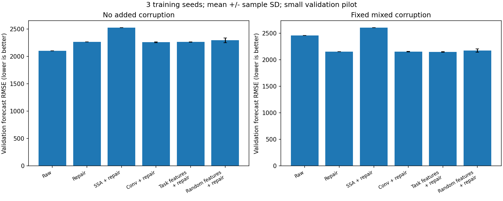
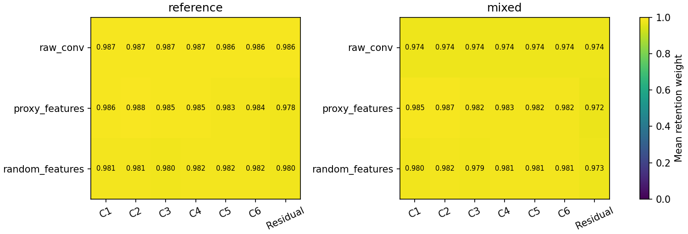

# 第二轮：无额外污染对照与 TASK 式任务特征

本轮已完成 18 次真实数据验证集运行，及 12 个已训练特征选择器案例的训练前后诊断。结论是：共享任务特征使成分权重更有区分，但尚未形成可靠的独立预测增益；完整串联中观察到很小的改善，仍需验证。

## 实验前锁定的设计

代码提交：`d976fa4`。协议：[round02_protocol.json](../configs/round02_protocol.json)。保留首轮数据、窗口、模型训练预算、权重偏置与修复参数，仅增加特征对照及评价范围控制。

| 项目 | 设置 |
|---|---|
| 数据 | Tetouan Zone 1，输入三天，预测一天 |
| 窗口 | 36 个训练窗口、12 个验证窗口，仍为工程子集 |
| 输入条件 | 原观测不再额外加噪；原观测加固定混合污染 |
| 选择器 | 原卷积；预训练代理特征；随机冻结特征 |
| 可训练选择参数 | 原卷积 161；两个匹配特征头均为 33 |
| 训练种子 | 42、43、44，控制代理初始化及训练随机性 |
| 污染种子 | 固定为 42，所有训练种子和选择器看到同一污染时间线 |
| 代理 | 相同结构和预训练条件，选择器训练阶段始终冻结 |
| 权重初始化 | 保留 sigmoid 偏置 4，不在本轮同时调整初始化 |
| 匹配特征头 | 同为 32 维特征输入及单层 sigmoid；初始头参数完全相同，初始化种子 731 |
| 评价范围 | 仅训练/验证，不构造测试历史窗口，不保存测试预测 |
| 最终预测器 | 每种处理分别拟合 Ridge，alpha 固定为 1 |

总运行数为 2×3×3＝18。每次保留六组处理，因此完整指标表有 108 行。固定处理重复运行只是检查对照一致性，不算多个独立数据实验。

“随机冻结特征”使用同一次代理初始化时的第一层权重，随后冻结；“预训练特征”使用该层预训练后的权重。两者面对同一预训练预测代理，只有用于判断成分的特征是否经过预训练这一点不同。原卷积组与特征组的结构和参数量不同，不能仅凭二者比较把差异归因于预训练。

这是借鉴你本地 TASK 的两处实现：`base_classes.py` 中先提取任务特征再生成权重，以及 `base_models.py` 中简单的 sigmoid 选择头。本轮没有引入 TASK 的交替优化，也没有使用 EEGNet。

## 独立预测器的验证结果

以下是 3 个训练种子的均值 ± 样本标准差，RMSE 越低越好。固定组因数据和算法均不变，重复结果一致，不显示 ±0。

| 处理 | 无额外污染 | 固定混合污染 |
|---|---:|---:|
| 不处理 | 2102.49 | 2461.02 |
| 固定 SSA | 2493.18 | 3078.19 |
| 单独修复原型 | 2264.75 | 2155.98 |
| 固定 SSA → 修复 | 2527.20 | 2607.53 |
| 原卷积任务 SSA | 2102.48 ± 1.66 | 2460.64 ± 0.63 |
| 共享任务特征 SSA | 2129.74 ± 39.11 | 2465.82 ± 2.30 |
| 随机特征 SSA | 2112.66 ± 12.04 | 2463.66 ± 12.82 |
| 原卷积任务 SSA → 修复 | 2259.76 ± 7.71 | 2155.68 ± 6.71 |
| 共享任务特征 SSA → 修复 | 2264.84 ± 3.66 | 2150.73 ± 5.05 |
| 随机特征 SSA → 修复 | 2295.17 ± 45.27 | 2175.34 ± 30.24 |

这些是验证集成绩，不能直接与首轮测试集上的 2820.64、2578.35 等数字比较。

### 对结果的解释

1. 人工污染使不处理的 RMSE 从 2102.49 增至 2461.02。修复原型在污染条件下可降至 2155.98；但在无额外污染条件下，修复反而将 2102.49 增至 2264.75。这支持“处理应考虑污染条件”，不支持不加区分地清洗所有输入。原观测也并非绝对干净信号。
2. 污染条件下，共享特征单独使用的 2465.82 没有优于不处理的 2461.02，也没有优于原卷积的 2460.64。不能声称共享特征已经让 SSA 插件有效。
3. 接修复后，共享特征组为 2150.73，相较单独修复的 2155.98，仅降低约 0.24%；相较原卷积串联，三个配对种子中赢两次，配对差为 −4.94 ± 8.26。样本少且差距小，不能声称有稳定优势。
4. 共享特征串联相较匹配随机特征串联也赢两次，配对差为 −24.61 ± 34.94。均值差受种子影响，仍只是进一步检验的线索。
5. 无额外污染条件下，全部“接修复”的组合均比不处理差。该设置中的串联没有同时兼顾正常输入与污染输入。

## 权重与代理诊断

污染条件下，验证窗口内各成分权重标准差的种子均值：原卷积为 0.000580，共享特征为 0.007870，随机特征为 0.006728。共享特征组比原卷积更有成分区分，但总体权重仍接近保留输入。

共享特征的成分标准差在训练前已经是 0.007791，训练后为 0.007870。因此不能把最终权重的全部差异解释为任务损失学出的结果；特征表示和初始权重头本身已造成差别。

污染条件下，冻结代理在原观测上的平均 MSE 为 0.140355，在污染输入上为 0.173773，共享特征重构后为 0.171627（均为标准化单位）。代理误差有小幅改善，但独立 Ridge 没有同步改善。这再次提示：对代理有用，不自动等于对独立模型有用。

权重头的 33 个参数不包含冻结特征提取器：本例选择器对象总共包含 13,889 个参数，其中 13,856 个为冻结特征参数。共享模式复用代理的第一层，部署为独立插件仍需保留这些权重和相应前向计算。

## 事后补充：权重头训练到底贡献了什么

看到上述权重记录后，追加一项诊断，**不属于实验前锁定的主对照**。从已保存的代理和初始权重头恢复“尚未训练选择头”的输出，再与训练后的输出分别拟合相同 Ridge。没有新神经网络训练，没有测试评价。“训练前”仍包含已预训练的代理特征，不是整个系统完全随机。

| 污染输入的共享特征处理 | 选择头训练前 RMSE | 训练后 RMSE |
|---|---:|---:|
| SSA 插件单独使用 | 2466.23 ± 2.39 | 2465.82 ± 2.30 |
| SSA 插件 → 修复 | 2162.55 ± 17.66 | 2150.73 ± 5.05 |

单独插件的训练贡献很小。串联平均改善 11.82，但配对差的样本标准差为 19.82；这仍不足以证明稳定收益。训练前后诊断可以确认参数更新产生了可测的输出影响，不能把它扩大为“已经学会区分信号与噪声”。

该诊断同时核对初始头哈希及初始权重均值，训练后权重与原运行文件一致，重建出的最终验证预测也与原保存预测一致。完整配对数字见结果文件。

## 核查、记录与范围

- 12 项检查全部通过。新增检查覆盖验证集模式不构造测试窗口、固定污染种子独立于训练种子，以及匹配特征头的参数数目、初始化一致性、梯度和特征冻结。
- 18 次运行全部成功。结果审计通过：同种子代理参数哈希一致，两个特征头初始化哈希一致，同条件污染相同，窗口位置相同，代理未更新，固定处理结果一致。
- 原卷积／污染／种子 42 的六组验证 RMSE 与首轮对应验证结果完全相同，兼容性差异为 0。
- 18 次程序内部总计约 118.84 秒，其中学习阶段合计约 80.68 秒；这是每次程序内部计时相加，不含进程启动、阅读分析、开发和后续诊断时间，也不是全量论文实验成本。多次复用了 SSA 缓存。
- 所有原始运行文件保留在本地 `runs/round02_initial/`。小型汇总、诊断与图表进入 Git；数据、模型权重及逐点预测不进入 Git。
- 训练种子重复不等于多污染实现或多数据集；所有种子共用 12 个验证窗口。均值和标准差不是独立样本显著性证据。
- 修复仍是未校准作者 Java 版本的 Python 原型；代理预训练使用人工污染前的参考历史，仍保留首轮的参考条件。
- 首轮曾查看探索性测试成绩，本轮没有再评价测试集；正式结论仍需要锁定方案并安排未参与设计的留出评测。

## 下一小步

暂不同时引入交替训练、更多网络或更多数据集。下一轮只比较共享特征选择器的权重初始化：保持数据、代理、训练预算与修复参数不变，比较现有偏置 4 与偏置 0。

- 如果权重区分变明显、验证与独立预测也改善：初始化值得进一步验证；不能单凭此确定梯度饱和是唯一原因。
- 如果权重变化更大而预测没有改善：不能把“权重有区别”当成学习成功。
- 如果代理改善而独立预测仍不改善：优先检查代理目标与插件可迁移性，再考虑增加模型复杂度。

本轮不宣称方法具备论文创新性，也没有选用测试成绩调整配置。

## 可复查文件

- [逐次指标](results/round02/metrics.csv)、[均值与标准差](results/round02/summary.csv)
- [配对对照](results/round02/paired_comparisons.csv)、[权重及代理诊断](results/round02/diagnostics.csv)
- [主实验审计](results/round02/audit.json)
- [训练前后逐次指标](results/round02_initial_heads/initial_vs_trained.csv)、[训练前后配对变化](results/round02_initial_heads/paired_changes.csv)

