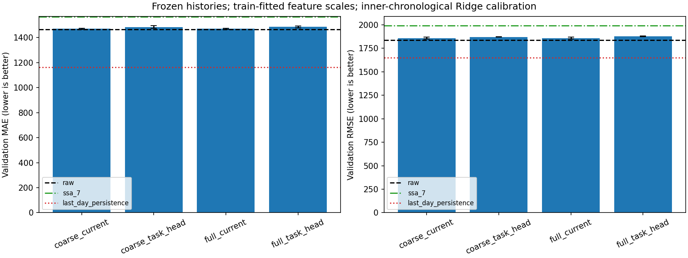

# 第八轮：冻结输出后的尺度公平与 Ridge 选参诊断

按本轮要求，复用已有单变量任务加权输出，统一控制输入尺度，在训练段内部按时间选择Ridge正则强度，再评价原始输入、固定前七、任务加权、常数缩放及昨日基线。

**结果：校准后的原始输入RMSE为1835.14，常数缩放与它数值一致。四种任务设置的三种子均值为1858.23–1877.94，12个任务版本的RMSE均未超过原始输入；昨日基线仍为1647.79。当前已有模型未显示额外的独立预测收益。**

没有重训任何神经网络，没有加人工污染、接入SRD或评价测试集。本轮是已有模型的读出校准诊断，**不是整个上游/下游流程的严格嵌套验证或新独立测试**。已有任务权重用过完整训练段标签，原神经检查点也参考过当前验证集；该边界在执行前已记录。

## 执行前固定的设置

源码和 [协议](../configs/scale_fair_protocol.json)在运行前提交为 `87aa8cf`。

- 原有251个训练窗口、54个验证窗口，过去432点预测144点、日步长144、原始未来目标不变。
- 读出统一使用 `StandardScaler → Ridge`。对432个历史位置分别估计均值、标准差，每折只用该折训练前缀拟合新的标准化参数。不是对每个窗口单独归一化，也不归一化未来目标。
- 正则候选固定为 `1e-4,1e-3,1e-2,1e-1,1,10,100,1000,10000,100000,1000000`，所有表示使用相同候选及选择预算，不看外层验证成绩扩大搜索范围。
- 内层采用三个扩展训练前缀：100训练/50内验证、150/50、200/51。每个内验证块紧接其训练前缀。
- 根据三个内验证块合并后的逐点MSE选择alpha，误差数值相同时选更大的alpha；检查每折训练目标结束时间不晚于内验证首次预测时刻。
- 选定alpha后，在全部251条训练历史上重新拟合标准化和Ridge，评价原有54个验证窗口。最终读出用float64/SVD，并与直接Cholesky求解逐例核验。

内层只选择Ridge的参数。原有SSA及神经处理结果没有按内折重新训练或分解，因此其完整训练段信息仍在冻结表示中；不能把内折成绩解释为整个去噪流程的无偏泛化估计。

## 校准后的验证结果

MAE、RMSE均为原量纲，越低越好。学习版本给出三个已有训练种子的均值±样本标准差；固定与常数恒等对照不伪装成多个独立数据实验。

| 输入／预测方法 | 内层选定alpha | 验证MAE | 验证RMSE |
|---|---:|---:|---:|
| 原始输入＋校准Ridge | 100 | 1465.55 | **1835.14** |
| 固定前七＋校准Ridge | 1000 | 1565.11 | 1990.49 |
| 前六＋残差，原选择头 | 各种子100 | 1470.32±4.93 | 1858.26±10.05 |
| 全部成分，原选择头 | 各种子100 | 1470.79±4.51 | 1858.23±9.92 |
| 前六＋残差，TASK式头 | 各种子100 | 1484.50±10.79 | 1870.99±2.63 |
| 全部成分，TASK式头 | 各种子100 | 1485.79±7.20 | 1877.94±3.88 |
| 仅常数缩放＋校准Ridge，12个对照一致 | 各100 | 1465.55 | **1835.14** |
| 昨日同一时刻直接预测 | 不需要 | **1162.39** | **1647.79** |

各组所选alpha都不在预定网格边界。固定前七内层选择1000，即使其外层成绩比另一个设置差，也没有改用外层成绩重新选参数。



全部逐次结果见 [metrics.csv](results/scale_fair/metrics.csv)，三种子汇总见 [summary.csv](results/scale_fair/summary.csv)，完整内层候选成绩见 [inner_cv_scores.csv](results/scale_fair/inner_cv_scores.csv)。

## 说明了什么

### 原始预测器此前没有校准充分

原始Ridge从先前固定alpha=1的2344.42变为本轮1835.14，降低约21.72%。这里同时统一了每个历史位置的尺度并选取正则强度，不能把改善归于某一个操作，更不是去噪收益。

新的标准化单独配上alpha=1，原始输入RMSE反而为2900.82；之后训练段内选参才降到1835.14。因此标准化不是自动改善分数的操作，尺度变化后应重新校准正则强度。

### 常数缩放的优势完全消失

每个常数s仍取自对应已有模型的训练权重均值，不根据外层预测成绩选择。经过按训练历史拟合的标准化后，s×原始输入与原始输入应具有相同表示。

12个实际对照中，标准化后最大输入差约1.07e-14，内层MSE最大差约1.55e-15，外层逐点预测最大差约2.26e-11（原量纲），且都选择同一alpha=100。这验证了尺度控制确实移除了纯常数幅度带来的评价差异。

见 [scalar_identity_checks.csv](results/scale_fair/scalar_identity_checks.csv)。

### 已有任务加权没有超过校准后的原始输入

12个任务版本的验证RMSE全部高于1835.14，四组平均高约1.26%–2.33%。三种子均值的MAE也均更高；个别种子的MAE存在很小的局部改善，不能将其写成所有指标逐例一致变差。

上一轮TASK式选择头相对原头的明显独立Ridge优势，本轮没有保留。这支持此前结果受读出尺度/正则化设置影响的判断，但没有单独识别每个机制的因果贡献。它不证明TASK在其他数据或分类任务上无效。

### 固定前七的表面优势也依赖比较设置

上一轮固定前七优于未校准原始Ridge；本轮按统一协议校准后，原始Ridge反而更好。说明只与一个未经充分校准的预测器比较，容易夸大预处理的价值。

固定前七的1990.49较其上一轮1926.56更高，本轮标准化但固定alpha=1为1941.99。内层选择的参数不保证在外层最优。当前没有根据这些外层数字反向改选alpha或修改候选表。

### 昨日基线仍有明显优势

昨日预测的1647.79仍优于本轮校准Ridge和已有任务输出。因此仅移除尺度混淆，没有把预测基线问题全部解决。目前不能声称获得了有竞争力的预测插件或恢复了干净信号。

## 核验与复现

34项检查通过，新增覆盖时间前缀、仅拟合内训练尺度、常数缩放在选参和预测中的恒等关系。本轮实际运行包含26种冻结表示×3折×11个候选，共858次内层候选拟合；另保存固定alpha=1的标准化诊断和最终求解器核验。

最终SVD与Cholesky逐点预测最大差约1.48e-10（原量纲）。来源24份处理历史/权重文件的SHA256在运行前后完全一致，没有修改已有模型输出。图形已查看。

运行目录为 `runs/scale_fair_initial/`，执行源码提交 `87aa8cf`，约10.4秒。完整预测、每个历史位置的标准化参数保留本机；小型指标、图和审计同步到 `docs/results/scale_fair/`。

```powershell
./scripts/run.ps1 -Mode scale_fair
./scripts/run.ps1 -Mode tests
```

入口依赖本机已存在的第七轮运行；如果来源缺失会报错，不自动替换为新训练或其他数据。每次要求新输出目录。

审计文件：[数据与时间折](results/scale_fair/data_audit.json)、[来源文件哈希](results/scale_fair/source_hashes.json)、[求解器差异](results/scale_fair/solver_checks.csv)、[执行元数据](results/scale_fair/metadata.json)、[逐窗口误差](results/scale_fair/per_window_metrics.csv)。

## 适用范围与后续判断

本轮只回答已有冻结表示在控制读出尺度和训练段内选参之后有没有增量，答案是在这些设置下尚未看到。没有重训更公平的上游模型，也没有完成严格端到端嵌套验证：神经表示用过全部外层训练标签，神经检查点参考过现有外层验证，原全局序列标准化和SSA也沿用外层训练设置。

如果继续研究，应先固定评价协议、建立能利用日规律的合格预测基线；如需确认新的上游设计，应使用严格分开的训练/选择/确认流程，不能反复用当前验证集寻找成功设置。这一轮不据此切换分类、加入人工污染或扩大网络。
