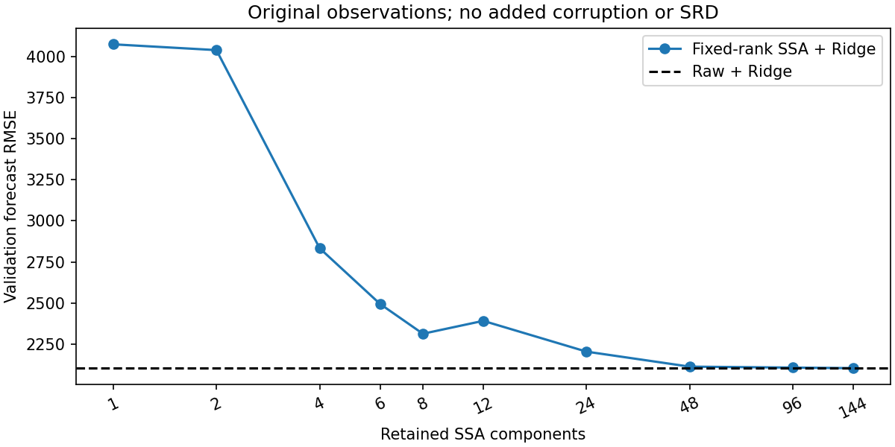
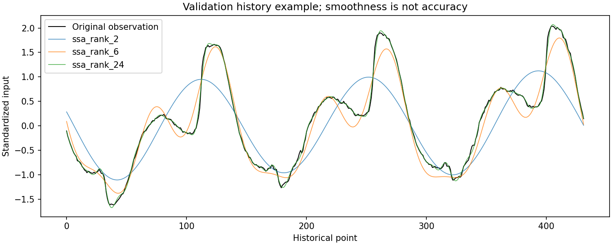
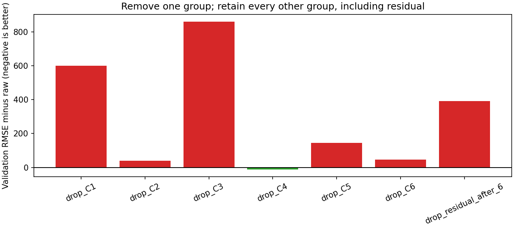

# 第五轮：只看原始观测上的 SSA

按本轮要求，**不加人工污染、不接 SRD，只检查 SSA 重构是否帮助下游预测**。当前小规模验证没有显示稳定收益：固定截断到前 6 个成分明显变差，冻结和协同训练的任务权重平均也略差于直接预测。保留更多成分时整体接近不处理。

这不是“SSA 在所有任务上无效”的结论。当前只覆盖一个数据集、一个独立预测器和少量验证窗口；也没有绝对干净信号来评价真实去噪误差。

## 问题与固定设置

数据仍是 Tetouan 城市电力 Zone 1 的原始观测，52,416 行、10 分钟采样。时间划分 70%/15%/15%，标准化仅用训练段拟合。只构造 36 个训练窗口和 12 个验证窗口，不构造或评价测试窗口。

每次用过去 432 点（3 天）预测未来 144 点（1 天），候选窗口步长 144，分别在训练和验证段均匀抽取原有窗口。各组使用完全相同的窗口和原始未来目标。每次 SSA 只分解该次预测已经观测到的历史窗口，未把未来目标放进分解。

- SSA 嵌入长度 144；学习版本是前 6 个单成分重构加一个精确残差组，共 7 组。
- 任务代理沿用小型 MLP，先预训练。权重头 33 个参数；冻结对照只更新头，协同组交替更新头、代理及共享特征。两组保持相同初始化、批次顺序、优化器和 15 轮头训练预算。
- 两种学习机制各重新训练 42/43/44 三个种子，共 6 次训练。学习过程和上一轮原始输入条件逐项核验一致；移除后续修复不应改变前面的训练。
- 独立下游仍为 Ridge，alpha=1，每种输入处理分别拟合预测器。本文所有最终数值统一使用 float64 和 Cholesky 直接求解，下面单独记录数值修正过程。
- 固定诊断预列保留阶数 1/2/4/6/8/12/24/48/96/144；逐一删掉前六组或残差组，报告全部结果。不能把同一验证集上的最好一项当成已经确认的新方法。

原始观测不是保证无噪声的真值。“不加污染”指不再人为修改数据；不意味着数据本身不存在测量误差。

## 主要结果

MAE、RMSE 均为原量纲，越低越好。学习版本给出三个训练种子的均值 ± 样本标准差；固定处理是确定性的，不伪装成三个独立实验。

| 输入处理 | MAE | RMSE |
|---|---:|---:|
| 原始输入，直接预测 | 1553.63 | **2102.16** |
| 固定 SSA，只保留前 6 个成分 | 1887.61 | 2493.78 |
| 任务加权 SSA，冻结代理 | 1575.08 ± 33.15 | 2129.73 ± 39.63 |
| 任务加权 SSA，协同更新 | 1567.83 ± 15.80 | 2122.56 ± 18.54 |

任务权重比直接截断前六个成分更好地保留了预测信息，但其平均结果仍未超过原始输入。这里比较的是独立预测器，不以训练代理自己变好作为成功依据。三个训练种子共享同一份数据和验证窗口，标准差只体现训练随机性。

逐次结果：[learned_metrics.csv](results/ssa_only/learned_metrics.csv)；汇总：[learned_summary.csv](results/ssa_only/learned_summary.csv)。

## 固定 SSA 保留多少成分

| 保留前 K 个成分 | 验证 RMSE |
|---|---:|
| 1 | 4076.38 |
| 2 | 4041.06 |
| 4 | 2833.22 |
| 6 | 2493.78 |
| 8 | 2311.94 |
| 12 | 2390.53 |
| 24 | 2202.88 |
| 48 | 2111.41 |
| 96 | 2105.59 |
| 144（完整重构核验） | 2102.16 |

预列的截断方案均未优于原始输入。保留更多成分后整体接近原始输入，但不是严格单调变化。保留全部 144 个成分只是验证重构正确，不能称为去噪收益。





前六个成分的平滑重构可能同时删除对预测有用的变化。这是与结果一致的解释，尚不能据此确定每个被删成分的物理含义。平滑程度、与输入差多少都不是本实验的成功指标。

## 逐组删除：有没有特别妨碍预测的组

从原始输入开始，每次仅去掉一组，其余组全部保留。这里 C1…C6 是每个窗口按奇异值排序的单成分重构；“残差”包含第六组之后的所有信息。组号不是跨窗口固定的频率或噪声类别。

| 删除的组 | MAE | RMSE |
|---|---:|---:|
| C1 | 2111.43 | 2703.13 |
| C2 | 1610.74 | 2142.69 |
| C3 | 2335.76 | 2962.08 |
| C4 | 1643.58 | **2090.49** |
| C5 | 1716.33 | 2246.91 |
| C6 | 1624.66 | 2147.47 |
| 第六组之后的残差 | 1887.61 | 2493.78 |

删 C4 的总体 RMSE 比原始输入低约 **0.56%**，但 MAE 反而高约 **5.79%**，且只有 12 个窗口中的 5 个 RMSE 变好。它是同一验证集上七种删除操作中的最好 RMSE，没有独立确认。因此仅保留为探索性现象，不能称 C4 是噪声，也不据此宣布获得有效去噪插件。

删残差等价于只保留前六个成分，结果一致。详见 [19 组固定诊断](results/ssa_only/static_metrics.csv) 和 [逐窗口结果](results/ssa_only/per_window_metrics.csv)。



## 数值核验发现的问题与修正

最初完整重构与原始输入最多只差约 1.21e-14（标准化量纲），但默认 Ridge LSQR 的近似求解产生了最大约 3.74 的逐点预测差异（原量纲），没有通过恒等输入对照。这不是 SSA 带来的预测收益。

我们保留了失败记录，随后将**本轮全部处理统一**改为 float64 Cholesky 直接求解，alpha 仍为 1。完整重构与原始输入的最大逐点预测差降到约 1.64e-10；收紧 LSQR 容差至 1e-12 也得到接近直接求解的结果。带精确残差的全成分相加与原始输入逐点完全一致。

因此本轮原始输入 RMSE 从旧默认 LSQR 的 2102.4934 变为 2102.1628；两个数来自不同数值求解设置，不能直接混用。该修正没有重新训练或更改任何神经网络权重，只对已保存的处理后历史重新拟合独立 Ridge。历史轮次原结果和原配置仍保留，不追溯覆盖。

这项修正在发现恒等对照失败后才作出，**不是事前设置**；阶数列表和删除方案则在执行前已经提交。记录见 [求解器核验](results/ssa_only/numerical_audit.csv)、[相同历史的读出差异](results/ssa_only/readout_solver_comparison.csv) 和 [总审计](results/ssa_only/audit.json)。

## 执行版本与复现

| 阶段 | 源码提交 | 本地保留目录 |
|---|---|---|
| 6 次神经网络训练；最初静态恒等核验失败 | `d4fff3a` | `runs/ssa_only_initial/`，其中失败诊断为 `static_diagnostics/` |
| 修正静态读出，完成 19 组诊断 | `8306905` | `runs/ssa_only_initial/static_diagnostics_stable/` |
| 统一 float64 读出，确认本报告汇总 | `2fc9850` | `runs/ssa_only_initial/summary_confirmed/`，预测为 `readout_summary_confirmed/` |

小型指标、图形和审计同步到本目录下的 `results/ssa_only/`；原始数据、模型权重、预测数组、缓存和运行日志保留本机，不上传。最初 6 次运行后手动执行静态诊断；现入口已将两步串联。

进入工程，用已有 Python 环境执行：

```powershell
# 仅固定 SSA：不需要 TensorFlow 或 Java
./scripts/run.ps1 -Mode ssa_static

# 两种任务训练各三个种子，再运行固定 SSA 诊断；不使用 Java
./scripts/run.ps1 -Mode ssa_only

# 核验工程
./scripts/run.ps1 -Mode tests
```

对本机本轮已有运行重新汇总时，指定一个新输出目录：

```powershell
python scripts/summarize_ssa_only.py --run runs/ssa_only_initial --static runs/ssa_only_initial/static_diagnostics_stable --out docs/results/ssa_only_recheck
```

未来全新 `ssa_only` 运行的静态目录名为 `static_diagnostics`；本轮因保留了首次失败目录，修正结果另存为 `static_diagnostics_stable`。已执行的固定入口复查保留于 `runs/ssa_static_entry_check/`，与最终静态数值一致。

24 项检查全部通过，包括原始输入路径不调用污染函数、无污染参数约束、完整重构、分组恒等关系、删除操作与直接 Ridge 的恒等对照，以及已有训练阶段隔离、Java 接口等检查。训练和静态审计确认本轮未注入人工污染、未执行修复、未构造测试窗口。

## 这些结果支持什么，下一步如何小步推进

当前支持的判断是：**在本轮数据子集和预测设置下，强行截断 SSA 的损失超过收益，任务权重尚未带来稳定的独立预测收益。** 不能仅凭曲线变平滑说去噪成功，也没有干净真值计算恢复质量；`input_change_rms_z` 只表示改动幅度。

36 个训练窗口对于 432 维输入的预测器非常少，12 个验证窗口也不足以判断微小改进是否稳定。本轮只提供排错和方向证据。SSA 在这里是预测前的输入重构，并没有检验 SSA 自身的递推预测算法。

下一小步仍留在原始数据与 SSA：锁定本轮划分、预测目标和处理规则，扩大训练与验证窗口数量，先重复原始输入与固定 SSA 的比较，再决定是否值得继续训练选择头。若差距仍存在，优先检查截断对预测信息的损伤；若出现稳定改善，再在独立留出数据上确认。暂不加人工污染、不接 SRD，也不把删 C4 的验证最优当成已经选好的方案。
