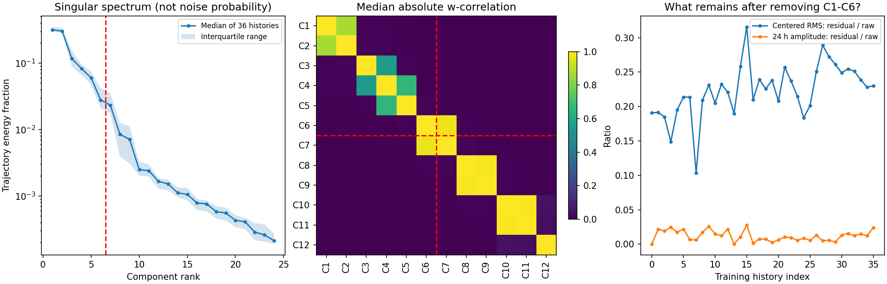
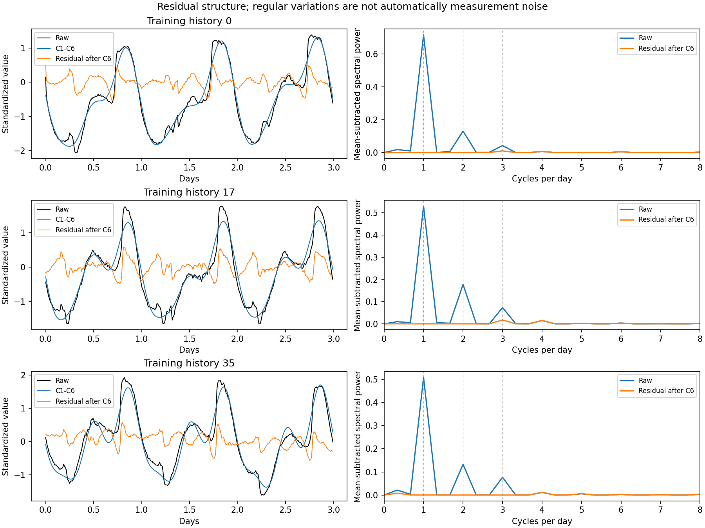
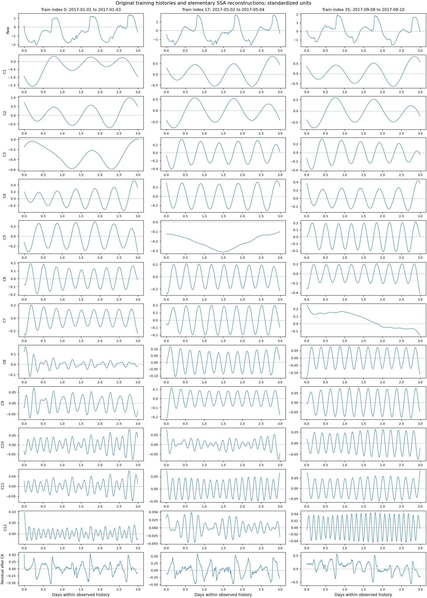
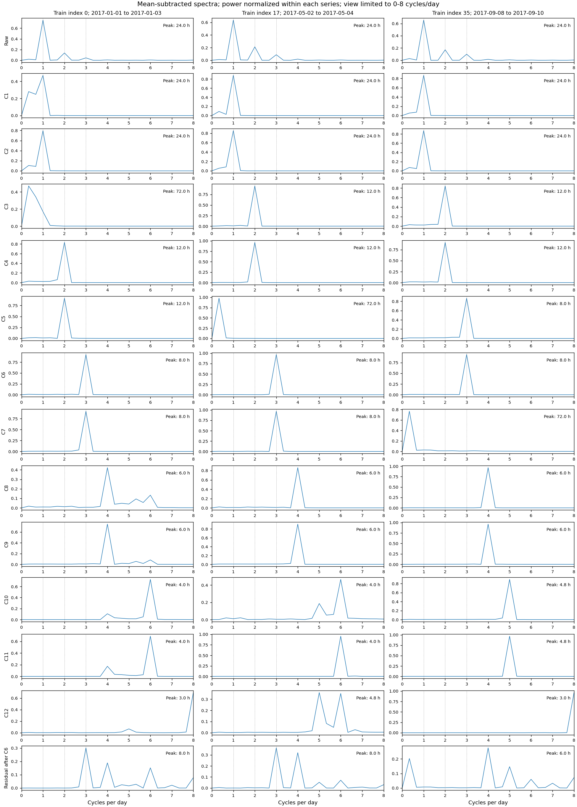

# 第六轮：原始训练数据的 SSA 结构诊断

本轮回答“前面的 SSA 到底分出了什么”。**仅分析原始训练历史，不加人工污染、不接修复、不训练或评价预测器，也不读取验证集成绩来选择分组。**

发现了明确的结构线索：36 个训练窗口中，23 个的 C6/C7 满足预列的候选成分对条件，而固定前六成分的边界正好拆开这对成分。残差也保留了规则的较短周期变化。该证据指出固定截断与粗残差分组的问题，尚不能证明新分组会提升预测。

## 范围与先后顺序

继续使用 Tetouan Zone 1、训练段标准化、432 点历史和嵌入长度 144。历史长度为 3 天，嵌入长度为 1 天。36 个窗口的位置与第五轮逐点一致。只读取训练段来构造历史，没有构造未来目标、验证历史或测试历史。

观察示例按位置选择第 0、17、35 个窗口，分别是 2017-01-01 至 01-03、05-02 至 05-04、09-08 至 09-10，选择不依据图形或成绩。

执行前提交 `dc648ba` 保存了协议、算法和检查；首次运行保留于 `runs/ssa_structure_initial/`。看到汇总后发现“不同窗口的峰值周期的中位数”可能不是任何窗口实际出现的峰值，随后在 `690b75c` 增加实际周期分布和众数，确认运行保留于 `runs/ssa_structure_confirmed/`。这项改进只补充描述性输出，未改变数据、分解、频谱、候选阈值或选择窗口。两次核心结果一致。

## 做了哪些诊断

1. 完整分解 144 个单成分重构，核验其和恢复输入；保存全部奇异值及轨迹矩阵能量比例。
2. 对前 24 个成分计算 SSA 加权相关性。权重是轨迹矩阵反对角线的计数，相关性采用加权内积除以加权范数，不额外减均值。图中展示绝对值。
3. 每个成分与残差单独减均值后计算矩形窗周期图，不做补零。以每天 144 点换算频率，完整历史的频率分辨率为每天 1/3 次。
4. 候选成分对同时要求：绝对加权相关性至少 0.8、两个奇异值的相对差不超过 20%、最大正频率谱峰在同一个频点。筛查前 24 个成分的全部 276 对。
5. 检查候选对是否跨越第 6 个成分的截断边界；量化残差的波动、24 小时正弦幅度，以及 24/12/8 小时三个频点的功率比例。

分组与可分离性的依据参考 [Golyandina 与 Korobeynikov 的 SSA 方法论文](https://arxiv.org/html/1206.6910)，其中使用成分波形、频谱、配对和加权相关性辅助分组。**本轮三个候选阈值是本工程的描述性规则，不是原论文提供的通用判别阈值，也不是已经验证的噪声识别器。**

## 发现一：固定前六成分经常拆开候选对

| 训练历史诊断 | 结果 |
|---|---:|
| 训练窗口数 | 36 |
| C6/C7 绝对加权相关性的中位数 | 0.9689 |
| C6/C7 奇异值相对差的中位数 | 1.44% |
| C6/C7 同时满足三项候选条件 | 23/36 |
| 其中共同主频峰为 8 小时 | 22/36 |
| 其中共同主频峰为 6 小时 | 1/36 |

固定前六成分保留 C6、丢弃 C7，23 个窗口因此跨越一组候选对。更高阶也存在成对现象，例如 C8/C9 在 32 个窗口、C10/C11 在 31 个窗口满足候选规则。它们的主要变化可能参与日内曲线的形状，不能仅因成分号靠后就称为噪声。

这与第五轮截断后预测变差相容，但不是因果证明。没有进行“保留配对后预测是否改善”的实验，也没有将候选对确认为独立物理来源。



中图是跨 36 个窗口的逐元素绝对相关性中位数；红虚线位于 C6/C7 之间。这个中位数图用于汇总，不是一条实际序列的相关矩阵，也不能替代每个窗口的分析。

原始逐窗口证据见 [pair_metrics.csv](results/ssa_structure/pair_metrics.csv)；成对汇总见 [pair_summary.csv](results/ssa_structure/pair_summary.csv)；截断检查见 [cutoff_diagnostics.csv](results/ssa_structure/cutoff_diagnostics.csv)。

## 发现二：主日周期已大体保留，残差仍有短周期结构

| 描述量（36 个训练窗口的中位数） | 数值 | 含义 |
|---|---:|---|
| 前六成分的轨迹矩阵能量比例 | 94.03% | 大部分矩阵能量已保留；不是预测信息保留率 |
| 残差/原始历史的去均值 RMS 比 | 22.70% | 残差波动仍有一定幅度；不是噪声占比 |
| 残差/原始历史的 24 小时正弦幅度比 | 1.14% | 残差里的主要日周期幅度较小；不是全部周期信息均被保留 |
| 残差中 24/12/8 小时频点的功率比例 | 22.40% | 仅统计这三个频点，占残差自身去均值功率的比例 |

残差最大正频率谱峰的分布为：6 小时 22 个窗口，8 小时 13 个，4 小时 1 个。这些是周期图上的描述性峰值，不表示残差全部来自确定周期，也不表示其余频率是噪声。6 小时、4 小时等更短的日内谐波不计入表中“24/12/8 小时”指标。

更准确的解释是：简单截断大体留下日周期，却可能改变峰谷形状和较短周期细节。当前没有干净真值，不能据此认定这些细节全部有用或全部属于测量误差。



上图右列使用实际去均值谱功率，可比较原始历史与残差的幅度。下面完整成分频谱图则在每条序列内归一化，适合比较峰的位置，不能从峰高比较不同成分的总能量。

## 发现三：成分号的含义会随窗口变化

例如 C6 在 35 个窗口的主峰为 8 小时；C7 却有 23 个窗口为 8 小时、6 个为 72 小时、6 个为 6 小时、1 个约为 6.55 小时。最后一个展示窗口中，8 小时结构主要出现在 C5/C6，C7 则主要表现为缓慢变化。

因此固定按成分号定义“第七个一定是什么”缺少依据。72 小时正好等于整个历史长度，只有一个周期，可能反映缓慢变化、谱泄漏或边界影响，不能当成可靠的 72 小时周期发现。

同理，C3 的跨窗口峰值周期中位数是 18 小时，但实际分布为 12 小时 18 个、72 小时 12 个、36 小时 3 个、24 小时 3 个，没有任何窗口的最大峰正好在 18 小时。新增分布输出就是为避免这种误读。





完整数值见 [component_metrics.csv](results/ssa_structure/component_metrics.csv)、[peak_period_distribution.csv](results/ssa_structure/peak_period_distribution.csv)、[component_summary.csv](results/ssa_structure/component_summary.csv)。显示频谱限于每天 0–8 次，指标从完整正频谱计算。不同面板的纵轴独立缩放。

## 对现有模型意味着什么

固定 SSA 的前六截断确有值得检查的结构问题。不过，现有任务权重模型不是直接丢弃残差：它保留了 C1…C6 以及一个包含 C7 之后全部信息的残差组。

该模型的具体限制是，C7 的规则振荡与其他剩余信息共用一个残差权重，无法单独调整；同时同一组号在不同窗口可能对应不同结构。这提供了检查分组设计的理由，**不能把任务模型尚未提升的原因全部归于 C6/C7，也不能保证细分后一定改善。**

## 下一小步与判断标准

先不增加网络、修复器或人工污染。下一项可做的单因素比较是：在同样原始数据上比较原始输入、固定前六、固定前七，以及“若 C6/C7 满足本轮候选规则则共同保留，否则保留前六”的固定规则。应先记录规则和评价预算，再运行，不能看完验证结果后调整阈值。

- 若加入 C7 或保护候选对稳定改善，说明成分分组值得进一步研究；还需确认是否超过原始输入。
- 若只比前六好、仍差于原始输入，只说明减少了一部分截断损失。
- 若仍无改善，说明配对结构不一定转化为预测收益，应继续检查其他被删信息或当前预测设置，而不能直接扩大网络期待解决。

本轮没有执行这项预测比较，没有新增预测成绩。训练窗口很少、历史仅 3 天；无法解析周周期，周期图分辨率有限。候选阈值未验证，跨窗口同一组号不保证相同语义，所有结果均为描述性诊断。

## 复现与核验

进入工程执行：

```powershell
./scripts/run.ps1 -Mode ssa_structure
./scripts/run.ps1 -Mode tests
```

输出目录要求新目录；脚本不依赖 TensorFlow 或 Java。原始输入、完整分解和相关矩阵保留在运行目录的 `training_decompositions.npz`；小型图表与审计同步到 `docs/results/ssa_structure/`。

28 项检查通过，新增检查包括：与现有 SSA 分解一致、完整重构、奇异值能量恒等式、加权相关性与嵌入矩阵内积等价、已知周期与幅值、三项候选条件。实际入口成功执行；独立核验本轮 36 条历史与第五轮完全相同，没有构造未来目标和留出历史。四张图均已查看。

确认运行版本、耗时与环境见 [metadata.json](results/ssa_structure/metadata.json)；数据范围与窗口见 [data_audit.json](results/ssa_structure/data_audit.json)；事前规则见 [protocol.json](results/ssa_structure/protocol.json)；核心汇总见 [summary.json](results/ssa_structure/summary.json)。
