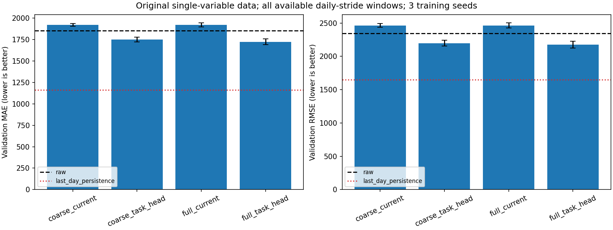
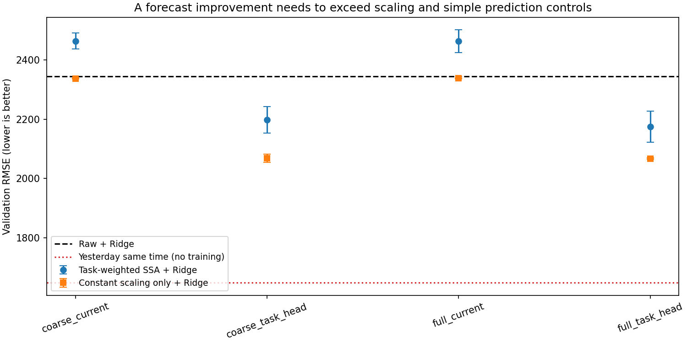

# 第七轮：单变量 TASK 迁移的设计核对与受控实验

本轮完成本机 TASK 代码核对、12 次协同训练、三个等预算原始代理对照、固定 SSA 和缩放对照。**未加人工污染、未接 SRD、未评价测试集。**

结论是：前六聚合和近乎全保留的选择头确实是额外设计假设。改用 TASK 式选择头后独立 Ridge 分数改善，但没有超过仅常数缩放的对照；所有这些方法还落后于昨日同一时刻的简单预测。当前不能宣布获得有效去噪插件。

代码逐项对照、哪些假设是本工程引入、哪些原实现细节不宜照抄，见 [设计核对报告](TASK_ALIGNMENT_AUDIT.md)。

## 数据与实验预算

- Tetouan Zone 1 原始观测，训练段拟合标准化，时间70%/15%/15%划分不变。
- 过去432点预测未来144点，日步长144；这次使用划分内全部可用窗口：251训练、54验证。不构造测试窗口。
- 选择器共享代理的32维特征，同一33参数头处理全部成分。代理18,608参数。每个案例先最多25轮预训练，再15轮协同，分别480次选择头和代理更新。
- 三个训练种子42/43/44。每种子四个案例的预训练权重、批次顺序、更新次数完全匹配。选择头核种子固定731。
- 主要读出统一为原量纲预测MAE/RMSE，Ridge alpha=1、float64、Cholesky，分别在处理后历史上拟合。神经检查点按验证代理MSE选择，独立Ridge不参与选轮次。
- 头设置对比是“偏置4且无范数约束”与“偏置0且max-norm 0.25”的组合变化，不把效果单独归因于某一项。

执行协议与源码在运行前提交为 `00091ea`，总运行约135.5秒。本轮窗口数和更新预算不同于旧36/12工程子集，不跨轮直接比较分数。

## 固定处理与简单基线

| 方法 | 验证MAE | 验证RMSE |
|---|---:|---:|
| 原始输入＋Ridge | 1850.68 | 2344.42 |
| 固定前六＋Ridge | 2269.88 | 2767.67 |
| 固定前七＋Ridge | 1507.61 | 1926.56 |
| 按既定C6/C7规则保护候选对＋Ridge | 1937.86 | 2347.69 |
| 全成分恒等重构＋Ridge | 1850.68 | 2344.42 |
| 昨日同一时刻值直接预测，不训练 | **1162.39** | **1647.79** |

前七比前六明显好，说明“前六足够”这个初始假设站不住脚。配对保护规则虽然有结构依据，却未超过原始输入；相关性高不等于该规则能提高预测。

前七对当前Ridge设置有收益，但它仍落后于简单持久性预测，不能据此声称方法已具有预测竞争力或恢复了干净信号。全成分重构是恒等核验，不能作为去噪成功。

逐项指标见 [fixed_metrics.csv](results/task_alignment/fixed_metrics.csv)，配对规则逐窗口取舍见 [pair_choices.csv](results/task_alignment/pair_choices.csv)。

## 任务加权：完整成分与选择头设置

以下为三个训练种子的均值±样本标准差，较低更好。标准差只体现本轮训练随机性，不是数据重采样置信区间。

| 成分与选择头 | 验证MAE | 验证RMSE |
|---|---:|---:|
| 前六＋残差，原选择头设置 | 1918.21±16.69 | 2464.32±27.32 |
| 全部成分，原选择头设置 | 1917.79±24.12 | 2463.27±38.72 |
| 前六＋残差，TASK式选择头 | 1747.09±27.31 | 2198.16±44.45 |
| 全部成分，TASK式选择头 | 1721.51±33.07 | 2175.17±52.13 |

在原头设置下，完整成分并没有稳定改善：三个种子的配对RMSE差为 +10.26、+0.28、−13.69。

在TASK式头设置下，完整成分相对聚合成分的配对差为 −7.85、−10.80、−50.34，三个种子均略好。该结果支持继续检查成分组织，但幅度有限，且仍未超过常数缩放及简单基线。

TASK式头初始 sigmoid 局部斜率明显更大。前六聚合组的平均初始斜率约从0.0161变为0.2353，全部成分组约从0.0175变为0.2493。实际最终保留均值在原设置下约0.983–0.985，在TASK式头下约0.507。这说明原初始化确实强烈偏向保留，但斜率变大和权重变化本身不是去噪证据。



完整逐次指标：[learned_metrics.csv](results/task_alignment/learned_metrics.csv)；[配对因素差异](results/task_alignment/paired_factor_differences.csv)；[训练诊断](results/task_alignment/training_diagnostics.csv)。

## 关键反证：只做常数缩放反而更好

用每次训练的**训练窗口权重均值**确定s，把原始历史统一乘以s；不做SSA筛选、不按验证成绩寻找s，然后照样拟合alpha=1的Ridge。

| 对应的训练案例 | 任务加权SSA的RMSE | 仅常数缩放的RMSE |
|---|---:|---:|
| 前六＋残差，原选择头 | 2464.32±27.32 | **2337.91±0.52** |
| 全部成分，原选择头 | 2463.27±38.72 | **2338.02±0.25** |
| 前六＋残差，TASK式头 | 2198.16±44.45 | **2068.02±13.66** |
| 全部成分，TASK式头 | 2175.17±52.13 | **2067.19±2.71** |

四组中，任务加权都没有超过各自的常数缩放对照。TASK式头对应的s约0.49–0.52；将alpha同时改为s²后，常数缩放逐例恢复到原始输入RMSE 2344.42，数值核验通过。

这表明当前Ridge成绩存在很强的尺度与正则化混淆：原始序列只改变幅度就能变好。因此2198或2175优于2344，不能被解释为已经学会去噪；也不能把常数缩放称为恢复了信号。

该对照只覆盖一个预定常数尺度，尚未分离所有可能的时变缩放或输入分布变化。当前结论是“未证明有超出简单尺度处理的增量”，不是对全部任务驱动分解框架的否定。



见 [scalar_controls.csv](results/task_alignment/scalar_controls.csv)，含全部补偿正则化的恒等核验。

## 代理变好是否只是继续训练

下面使用代理自己的预测，不能与独立Ridge的表格混作同一个预测器。均为三个种子的验证RMSE均值。

| 代理状态 | 验证RMSE均值 |
|---|---:|
| 只预训练、原始输入 | 2190.10 |
| 原始输入，追加同预算代理训练 | 1902.09 |
| 前六＋残差，原头，协同训练 | 1898.28 |
| 全部成分，原头，协同训练 | 1897.88 |
| 前六＋残差，TASK式头，协同训练 | 1849.31 |
| 全部成分，TASK式头，协同训练 | 1861.04 |

原头版本的大部分代理改善，可以由同预算继续训练复现。TASK式头相对该对照还有小幅改善，值得保留；不过仍未达到昨日持久性预测的1647.79，也没有充分区分尺度、隐式正则化与成分筛选的贡献。

原始输入对照具有相同预训练权重、批次顺序、优化器、480次代理更新和第1至15轮的验证选轮预算。它是训练过程诊断，不是新的去噪方法。没有从这些结果挑出某个种子作为最终成绩。

见 [proxy_controls.csv](results/task_alignment/proxy_controls.csv) 和 [proxy_summary.csv](results/task_alignment/proxy_summary.csv)。

## 代码与数据核验

31项检查通过，包括新增的零偏置/范数约束、145组不增加头参数、常数缩放的Ridge补偿恒等式。12次实际训练的运行审计全部通过：共享特征更新、两阶段参数隔离、检查点共同恢复、配对预训练和批次哈希、相同更新预算、无人工污染/修复/测试窗口。

另用保存的SSA成分和权重，独立重建了全部12次训练的训练/验证历史，与TensorFlow保存值的最大差为1.34e-6（标准化量纲，float64求和与float32计算差异）。权重形状与各自成分数一致，值均在0到1之间。

两张图均已查看。原始运行、模型权重、输入和预测数组保留在本机；仓库只同步小型图表、指标与审计。没有修改D盘TASK复现代码。

- 主运行：`runs/task_alignment_initial/`，执行提交`00091ea`。
- 事后描述性汇总：`runs/task_alignment_review/`，汇总代码提交`a356029`；未重新训练或调参。
- [训练审计](results/task_alignment/audit.json)、[数据范围](results/task_alignment/data_audit.json)、[执行版本与TASK文件哈希](results/task_alignment/metadata.json)、[逐窗口误差](results/task_alignment/per_window_metrics.csv)。

复现新的一轮，进入工程执行：

```powershell
./scripts/run.ps1 -Mode task_alignment
./scripts/run.ps1 -Mode tests
```

已有运行重新做描述性汇总，输出需使用新目录：

```powershell
python scripts/review_task_alignment.py --run runs/task_alignment_initial --out runs/task_alignment_review_recheck
```

## 当前判断与下一步

已经证实需要纠正的不是“SSA只应该留七个”，而是**未经验证的分组、强全保留初始化，以及未充分控制尺度和训练预算的解释方式**。更接近TASK的设置可以影响结果，却不自动构成有效去噪。

下一步先留在单变量原始数据，建立合格的预测基线，并统一或控制处理后输入的尺度和正则化，再判断任务选择是否有增量。暂不扩大网络或接回SRD。若优势在尺度控制后消失，应将当前效果解释为预测器适配；若能持续超过常数缩放、固定处理和简单基线，再设计独立留出确认。

本轮仍是一份数据、一个代理结构和一个独立读出，验证集已用于探索，历史长度、嵌入长度、隐藏维数、alpha和预算尚未系统验证。三个种子并非三个独立数据集，原始观测也不是绝对干净真值。当前不作新颖性、普适插件或真实恢复质量的主张。
